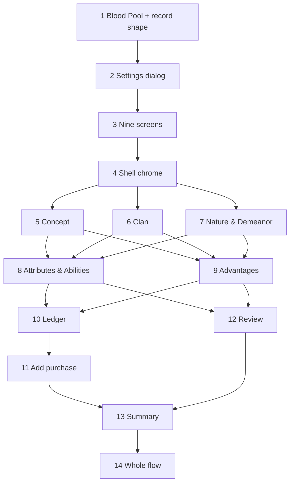

# Plan: Character Builder Redesign

**Created**: 2026-10-19
**Branch**: `feat/character-builder-redesign` (created at `/build`)
**Status**: in-progress
**Gherkin persistence**: features
**Spec**: `docs/specs/character-builder-redesign.md` (builds on `docs/specs/character-builder.md`, "the base spec"), with the plan-review amendments listed in its "Plan-review amendments" section

## Goal

Rework the shipped V20 character builder into the guided, story-first flow of the Figma
board (page `52:117`): a persistent shell (top bar, identity bar, phase sidebar, live
"Your character" panel), nine framed screens — Character concept, Clan, Nature &
Demeanor, Attributes, Abilities, Advantages, Finishing touches, Review & resolve, and a
closing Character sheet summary — creation settings in a dialog, an Add-purchase dialog
with a freebie ledger, and Starting Blood Pool as a required, explicitly recorded value.
The creation rules, the build model and the finished-character conversion are the base
spec's; the build record changes only additively. Built on the existing stack (Astro
static + vanilla TypeScript), reworking `build.astro`, `src/components/builder/`,
`src/scripts/builder/` and `src/styles/builder.css` in place.

**Decision-defaults stances** (confirmed by the user at the `/ship` gate and spec gate):

- **Scope** — a visual redesign of the existing steps plus only the new screens the
  frames show that the builder lacks. Export character sheet, Edit character, Merits and
  Flaws, photographs, sourcebook prose and re-opening a finished build are out. The three
  human-decided amendments (Blood Pool required; settings in a dialog; closing summary
  then Open sheet) are in.
- **Replace vs. merge** — edit in place. The build record changes additively only
  (`bloodPool: number | null`, two new concept strings); `schemaVersion` stays 1; a build
  saved before the change still opens. No migration. Roster, sheet and character store
  are not touched.
- **Source of truth** — V20 rules and the base spec win on numbers and limits; frames
  drive layout and UX; **WCAG 2.1 AA wins over the frames** where their contrast or
  semantics conflict.
- **Format fidelity / migrate-vs-stub** — not touched. Only names, numbers, page
  references and short original lines (≤ 12 words) are encoded; no sourcebook prose.
- **Integration** — the repo has no CI and the user reviews and merges: open PRs **without
  auto-merge**. Delivery is **three mergeable PRs** (see Merge points), each leaving the
  old e2e suite green.

**Not in this plan**: Export character sheet; Edit character; Merits and Flaws; photographs;
re-opening a finished build; Paths of Enlightenment; bloodlines; write-in Abilities;
experience points; other game lines.

## Merge points (safe to stop)

| PR | Slices | Why it stands alone |
| --- | --- | --- |
| 1 | 1–2 | The only changes to rules-adjacent data and the stored record (Blood Pool, record shape) plus the settings dialog. Smallest blast radius, most scrutiny. Old UI otherwise unchanged |
| 2 | 3–9 | Shell and the six restyled input screens. Finishing touches and Finish still work as before (old freebie controls kept) |
| 3 | 10–14 | Ledger, Add purchase, Review, closing summary and whole-flow verification |

`/build` stops at each boundary, runs the Pre-PR Quality Gate and waits for the user to
merge before starting the next block.

**Cut line** (first to drop if the work must shrink): the hero banner, the "What the
choices say" card, the "what finishing will deliver" card, audit provenance sublines,
the Ctrl/⌘+K shortcut. Load-bearing and never cut: RD-3, RD-13, RD-14/15, RD-17/24,
RD-18/19, RD-21, RD-25.

## User-facing terms

One word per concept, used in copy and Gherkin alike.

| Concept | Copy |
| --- | --- |
| A blocking item | "item(s) left" (Finish button, Continue hint); the Review tile reads "N items to resolve". Pools say "remain(s)" and sidebar states "Done / To do / Optional"; "Complete / Allocation needed" are pool meter words only |
| Blocking vs optional tag | **Required** (Blood Pool, clan, unplaced dots); Nature & Demeanor read **Optional** |
| Empty values | Blood Pool "Not recorded"; clan, Nature, Demeanor "Not chosen"; pools "Not allocated" |
| The last screen | sidebar "Character sheet"; its headline "<Name>. A story begins." |
| Phases vs screens | Phases: Character concept, Attributes, Abilities, Advantages, Finishing touches. Screens named as in the sidebar; Phase 01 and 05 show their screens indented beneath, so the same words never sit side by side |
| Spend | "freebie points" (never "freebies") |

## Acceptance Criteria and coverage

Full wording is in the spec; ids match. Ticked at PR review, not during build.
"Existing" means a feature file that already exists in `features/` and keeps running.

| AC | Criterion (short) | Covered by |
| --- | --- | --- |
| [ ] RD-1 | Shell regions on every screen | Slice 4 scenarios; Slice 14 |
| [ ] RD-2 | Sidebar, states in text, any order | Slice 3 |
| [ ] RD-3 | Back / Continue, reasons, inert when disabled | Slice 3 (+ gate copy in 3.1 unit tests) |
| [ ] RD-4 | Autosave status, Save & exit | Slice 4 |
| [ ] RD-5 | Settings dialog | Slice 2 |
| [ ] RD-6 | Concept screen | Slice 5 |
| [ ] RD-7 | Clan screen | Slice 6 |
| [ ] RD-8 | Nature & Demeanor | Slice 7 |
| [ ] RD-9 | Attributes | Slice 8 |
| [ ] RD-10 | Abilities | Slice 8 |
| [ ] RD-11 | Announcements, no colour-only meaning | Slices 8, 9, 10; Slice 14 |
| [ ] RD-12 | Advantages | Slice 9 |
| [ ] RD-13 | Humanity, Willpower, Blood Pool | Slices 1, 10 |
| [ ] RD-14 | Ledger and cost card | Slice 10; Slice 11.3 |
| [ ] RD-15 | Add purchase | Slice 11 |
| [ ] RD-16 | Merits and Flaws note | Slice 10 |
| [ ] RD-17 | Review & resolve | Slice 12 |
| [ ] RD-18 | Finish, confirmation, character content | Slices 5, 13 |
| [ ] RD-19 | Summary | Slice 13 |
| [ ] RD-20 | Base rules and refusals visible | Slices 2, 8, 9, 11 (refusal scenarios) |
| [ ] RD-21 | Old builds open, new fields round-trip | Slices 1, 5 |
| [ ] RD-22 | Roster and blank sheet unchanged | Slice 14 (explicit scenarios) + existing `features/roster-redesign/`, `features/v20-character-sheet/` |
| [ ] RD-23 | Look of the frames, contrast and class tests | Slice 3.2 extends the test globs; every slice runs them |
| [ ] RD-24 | Outstanding items exactly | Slices 1, 12 |
| [ ] RD-25 | Keyboard, names, headings, focus, AA | Each screen/dialog slice (DoD below); Slice 14 sweep |
| [ ] RD-26 | Search fields, shortcut hint, counts | Slices 6, 7, 9 |
| [ ] RD-27 | 375 px / 320 px | Each screen slice (DoD); Slice 14 |
| [ ] RD-28 | Unit and e2e coverage; suites green | Every slice; Slice 14 |

## Module layout

New or changed paths. Everything else keeps its role from `plans/character-builder.md`.

| Path | Role |
| --- | --- |
| `src/domain/v20/creation/build.ts`, `updates.ts`, `progress.ts`, `toCharacter.ts` | `bloodPool: number \| null`; `concept` gains `conceptKind`, `drive`; `setBloodPool` accepts a recorded value or blank; `outstanding` adds "Record a starting Blood Pool"; finish composes Concept and `notes` |
| `src/domain/v20/creation/rules.ts` | Data only. `SCREENS` (id, title, phase) replaces `BUILD_STEPS`; the `BuildStep` type becomes the nine-screen union here, so `allotments.ts`, `limits.ts`, `ratings.ts`, `result.ts`, `updates.ts` keep importing it from `rules.ts` with no cycle |
| `src/domain/v20/creation/screens.ts` | Behaviour only, importing downward: per-screen completeness, `gateReason(build, screen)` returning `{ text, goTo? }`, `screenStatuses(build)`. Derived from the build alone — no visited state |
| `src/domain/v20/creation/catalogue.ts` | `matchByName(items, query)` — the one case-insensitive trimmed filter. No data |
| `src/domain/v20/creation/sampleConcepts.ts`, `clanCards.ts`, `archetypes.ts`, `advantageViews.ts` | Per-screen view models, each owned by one slice; each holds its own original one-liners |
| `src/domain/v20/creation/poolViews.ts` | Pool meters, callouts, category summary (Slice 8) |
| `src/domain/v20/creation/shellView.ts` | Identity bar and "Your character" rows (Slice 4); named apart from the existing `src/domain/v20/identity.ts` |
| `src/domain/v20/creation/review.ts` | Review tiles, audit rows, finish label (Slice 12) |
| `src/domain/v20/creation/summary.ts` | The closing summary only (Slice 13); consumes `toCharacter(build)` and `report(build)`, never a third copy of the rating arithmetic |
| `src/domain/v20/creation/ledger.ts` | Read-only: ledger rows and total (Slice 10) |
| `src/domain/v20/creation/purchases.ts` | Mutations returning `UpdateResult`, built on `setRating` / `removeDiscipline`: `undoFreebieDots` (Slice 10), `purchase` (Slice 11) |
| `src/domain/v20/creation/purchasePreview.ts` | Pure read: `previewPurchase(build, draft)`, `purchasable(build, category)` (Slice 11) |
| `src/storage/buildStore.ts` | Record-shape handling in one function, `readStoredBuild(raw)` (see Design rules) |
| `src/scripts/builder/screens/<id>.ts` | One module per screen id, each exporting the `ScreenModule` contract |
| `src/scripts/builder/parts/*.ts` | Shared non-screen modules: dialogs, ranked rows, add-purchase, freebies, typed numbers |
| `src/styles/builder.css`, `src/styles/builder/*.css` | Shell, shared pieces (meter, callout, card, chip, breakpoints) in `builder.css`; one prefixed partial per screen |
| `src/styles/global.css` | New colour tokens only |
| `features/character-builder-redesign/` | One `.feature` per slice, exported from this plan (tool-owned) |
| `features/steps/builder-*.steps.ts`, `features/steps/support/builder.ts` | Updated for the new UI; later slices add their own `support/<screen>.ts` |

### Design rules that hold across every slice

**Record shape and legacy**

- A **new-shape record** always carries `concept.conceptKind` and `concept.drive`
  (written from Slice 1 on, defaulting to `''`) and a `bloodPool` of `null` or a whole
  number. A **legacy record** has no `concept.conceptKind`. Only for a legacy record does
  `readStoredBuild(raw)` map `bloodPool: 0` to `null` and default the two strings; a
  legacy non-zero value is kept. So a recorded `0` in a new record survives reload.
  `bloodPool` is excluded from the `hasShapeOf` template check (as `disciplines` is).
- `readStoredBuild` normalises a legacy record **before** the `hasShapeOf` check (which
  recurses into `concept`). A new-shape record with a malformed new field — a `bloodPool`
  that is not `null` or a whole number ≥ 0, a `conceptKind` outside the 14 names or `''`, a
  non-string `drive` — is **unreadable**; the store never judges the upper bound by
  generation (that is the domain's `violations()` / `outstanding()`, as for every other
  maximum), so a new-shape Blood Pool above its maximum opens and is listed: the roster and builder show the existing
  "could not be read" state and the record is never auto-deleted.

**Screen contract and data flow**

- `interface ScreenModule { id: ScreenId; wire(root, wiring): void; render(build, root): void }`.
  `builder.ts` loads `./screens/*.ts` (excluding `index.ts` and `*.test.ts`) with
  `import.meta.glob`, calls every `wire` once and every `render` after each commit. A unit
  test fails when a screen id has no module or a module has no known id (the repo's
  `checkTabFolders` precedent).
- Screens render **pure view models** called with `build` (plus an explicit screen-state
  object (owned by the screen module, module-local; not the existing `pageState.ts`) where needed — selected-but-empty Background chips, the active Nature/Demeanor
  role, search queries, the Add-purchase draft — passed in, never read from the DOM by the
  view model). A page script never compares a number against a budget or maximum.
- Dialogs and shared widgets live in `parts/`, not `screens/`. `finish.ts` reaches the
  summary through an exported `showSummary(build, characterId)` on the summary module.
- **Slice 3 does every extraction from `wiring.ts` and `renderControls`** (clan,
  Discipline rows, outstanding list, freebies, concept fields, typed numbers) into
  `screens/` or `parts/` as a behaviour-preserving split. After Slice 3 no slice edits
  `build.astro`, `builder.ts`, `wiring.ts` or `builder.css`, except Slice 4 (chrome,
  `build.astro`, `builder.ts`) and Slice 14.

**Pages**

- The screen is in the URL hash and changes with **`pushState`**, so browser Back steps
  back through screens; an unknown or not-yet-available hash (including the Character
  sheet screen before finish) shows Character concept. Focus moves to the screen heading;
  the title is "<Screen> – <name or Unnamed character>".
- **Disabled-but-explained**, one pattern everywhere (Continue, Finish, Add purchase,
  Confirm purchase, a rating "+" at its maximum): `aria-disabled="true"`, focusable, with
  `aria-describedby` pointing at a visible reason; activating it does nothing except
  announce the reason politely. A control that becomes unavailable while focused keeps
  focus. Native `disabled` is not used for these.
- **Dialogs** are native `<dialog>` + `showModal()`, labelled, closed by Escape and a close
  button, returning focus to the opener, each with its own `role="status"` region for
  refusals (referenced by the field's `aria-describedby`). Confirmations and undos
  announce a sentence ("Resources 2 to 5 added, 3 points, 2 remaining").
- **Autosave status**: success is text only (not announced); failure is `role="alert"`
  and says what to do ("Your browser could not store this. Free up space, then choose Try
  saving again; leaving now loses changes since the last save"), with a **Try saving
  again** button. "Saved just now" turns into "Saved N min ago" after 60
  seconds; e2e injects a fake clock.
- **Widgets**: clan list = radiogroup (arrow keys, roving tabindex); sample concepts,
  archetypes and Background chips = `aria-pressed` toggle buttons; the Nature/Demeanor
  role switch = radiogroup. Every control has a unique accessible name ("Increase
  Strength", "Undo Resources purchase"). Ctrl/⌘+K focuses the current screen's search
  field on every screen that has one, and the hint reads ⌘K on macOS, Ctrl K elsewhere.
- **Copy**: names and numbers; page references; original lines ≤ 12 words; no pronouns;
  callouts never use the character's name (neutral: "2 of 3 additional Physical dots are
  placed"). Step text in Gherkin is screen-specific ("I search the clans for …") so the
  global step namespace never collides.

**Definition of Done for every screen or dialog slice (5–13)** — part of each step's TEST,
not left to Slice 14: axe reports no WCAG 2.1 AA violations at 1512 px and at 375 px
(default **and** refusal/selected/callout states); no horizontal scroll at 375 px and at
320 px; exactly one `h1`; focus moves to the heading on arrival; every state word is in
text ("Complete", "Allocation needed", "Selected", "Required"); unique accessible names;
the existing contrast and class-name tests pass.

**Step text is defined once.** A repeated step text (the screen-standards steps, "Given a
Nosferatu build", "Then the Clan screen opens") is defined in the earliest owner's support
file (the generic standards steps in Slice 3) and imported thereafter; no later slice
redefines it.

**Old e2e features — replace, don't add.** `features/character-builder/*.feature` become
hand-maintained from Slice 1 (the old plan's export is marked superseded there). When a
slice's new feature covers an old scenario, that old scenario is deleted in the same
step; only scenarios describing behavior no new slice owns stay. Slice 3.4 splits the old
`slice-2-concept-step-and-step-navigation.feature` and `builder-concept.steps.ts` into
per-screen files (`slice-2a-concept`, `2b-clan`, `2c-nature`) so each wave-5 slice owns its
own. Later slices touch `features/steps/support/builder.ts` never; they add
`support/<screen>.ts`.

## Slices

### Slice 1: Blood Pool is recorded; the record shape gains its new fields

**Depends-on:** none
**Files:** `src/domain/v20/creation/build.ts`, `src/domain/v20/creation/rules.ts`, `src/domain/v20/creation/updates.ts`, `src/domain/v20/creation/progress.ts`, `src/domain/v20/creation/limits.ts`, `src/domain/v20/creation/toCharacter.ts`, `src/domain/v20/creation/rules-engine.test.ts`, `src/domain/v20/creation/updates.test.ts`, `src/domain/v20/creation/progress.test.ts`, `src/domain/v20/creation/toCharacter.test.ts`, `src/storage/buildStore.ts`, `src/storage/buildStore.test.ts`, `src/components/builder/FinishingTouches.astro`, `src/scripts/builder/wiring.ts`, `features/steps/support/seed.ts`, `features/steps/support/builder.ts`, `features/steps/builder-finish.steps.ts`, `features/character-builder/slice-7-finishing-touches-freebie-points-and-blood-pool.feature`, `features/character-builder/slice-8-finish-a-build.feature`, `plans/character-builder.md`

**Behavior:**

```gherkin
Feature: Starting Blood Pool is recorded by the player

  Background:
    Given I am building a character at 13th generation

  Scenario: A new build has no Blood Pool recorded
    When I open Finishing touches
    Then the Blood Pool field reads "Not recorded"
    And it is tagged "Required"
    And the hint reads "0 to 10 at 13th generation"

  Scenario: Recording a Blood Pool
    When I record a starting Blood Pool of 10
    Then the Blood Pool is no longer tagged "Required"
    And after reloading the builder it still reads 10

  Scenario: Zero is a recorded value that survives a reload
    When I record a starting Blood Pool of 0
    And I reload the builder
    Then the Blood Pool field reads 0 and is not tagged "Required"

  Scenario Outline: An invalid Blood Pool is refused and the entry is kept beside the message
    When I record a starting Blood Pool of "<entry>"
    Then the field is marked invalid and the message "The Blood Pool must be a whole number from 0 to 10." is announced politely
    And the field still shows "<entry>"
    And after reloading the builder the Blood Pool still reads "Not recorded"

    Examples:
      | entry |
      | 11    |
      | -1    |
      | 2.5   |
      | 10.0  |
      | +5    |
      | 1e1   |
      | ten   |

  Scenario: Clearing the field returns to Not recorded
    Given I have recorded a starting Blood Pool of 10
    When I clear the Blood Pool field
    Then the Blood Pool field reads "Not recorded" and is tagged "Required"

  Scenario Outline: The range follows the effective generation
    Given a build at base <base> generation with <dots> dots of the Generation Background
    When I record a starting Blood Pool of <entry>
    Then I am told the Blood Pool must be a whole number from 0 to <max>

    Examples:
      | base | dots | entry | max |
      | 4th  | 0    | 51    | 50  |
      | 6th  | 2    | 51    | 50  |
      | 13th | 1    | 12    | 11  |

  Scenario: An unrecorded Blood Pool blocks finishing
    Given a clan is chosen and every creation dot is placed
    Then the outstanding list includes "Record a starting Blood Pool"
    And Finish is aria-disabled, still focusable, and explains "Finish character · 1 item left"
    And activating Finish does nothing
    When I record a starting Blood Pool of 10
    Then the outstanding list is empty and Finish is enabled

  Scenario: A build saved before this change reads Blood Pool 0 as Not recorded
    Given a build saved before this change with a Blood Pool of 0
    When I open it in the builder
    Then the Blood Pool field reads "Not recorded"

  Scenario: A build saved before this change keeps a non-zero Blood Pool
    Given a build saved before this change with a Blood Pool of 7
    When I open it in the builder
    Then the Blood Pool field reads 7

  Scenario: Recording 0 on a pre-change build survives a reload
    Given a build saved before this change with a Blood Pool of 0
    When I open it in the builder and record a starting Blood Pool of 0
    And I reload the builder
    Then the Blood Pool field reads 0 and is not tagged "Required"

  Scenario Outline: Whitespace around a Blood Pool entry
    When I record a starting Blood Pool of "<entry>"
    Then the Blood Pool field reads "<result>"

    Examples:
      | entry  | result       |
      | " 10 " | 10           |
      | "010"  | 10           |
      | "  "   | Not recorded |

  Scenario: A new record with a malformed Blood Pool is unreadable
    Given a stored new-shape build whose Blood Pool is "ten"
    When I open it in the builder
    Then I am told the build could not be read
    And the stored record is unchanged

  Scenario: A pre-change build can be finished once its Blood Pool is recorded
    Given a build saved before this change with a Blood Pool of 7 and everything else placed
    When I open it, then finish it
    Then the character's sheet shows a blood pool of 7

  Scenario: A recorded zero reaches the sheet as zero
    Given a finishable build with a recorded Blood Pool of 0
    When I finish the build
    Then the character's sheet shows a blood pool of 0

  Scenario: A refusal is perceivable without colour
    When I record a starting Blood Pool of 11
    Then axe reports no violations with the refusal shown
    And the refusal is stated in text

  Scenario: The recorded Blood Pool reaches the finished character
    Given a finishable build with a recorded Blood Pool of 9
    When I finish the build
    Then the character's sheet shows a blood pool of 9
```

**Steps:**

#### Step 1.1: Record shape, nullable Blood Pool, store and conversion

**Complexity**: standard
**IMPLEMENT**: `bloodPool` becomes `number | null`, `blankBuild` starts at `null`; `concept` is typed `Record<ConceptField, string> & { conceptKind: string; drive: string }` (default `''`), the fourteen sample-concept names live as data in `rules.ts`, and `setConceptKind` (names or `''`) and `setDrive` are added to `updates.ts`; `setBloodPool` accepts a whole number from 0 to the generation maximum or a blank (→ `null`) and refuses everything else naming the range; `outstanding` adds "Record a starting Blood Pool" (item carries a `step` field, target `finishing`); `violations` ignores `null`; `toCharacter` writes the recorded value; `readStoredBuild` implements the legacy/new-shape and malformed rules in Design rules. `features/steps/support/seed.ts` seeds a recorded Blood Pool so the old e2e stays green.
**TEST**: Unit tests: every refusal (above range for 13th and 4th, negative, fractional, `1e1`, non-numeric), 0 accepted, blank clears, outstanding present/absent, conversion, store round-trips including **recorded 0 → 0**, legacy 0 → null, legacy 7 → 7, malformed new `bloodPool` (non-integer, negative) / `conceptKind` / `drive` → unreadable, a new-shape Blood Pool above its maximum → opens and `outstanding` lists it, `setConceptKind` / `setDrive` accept and refuse; full unit and e2e suites green.
**REFACTOR**: The range message lives where `limits.ts` already owns the maximum; delete default-0 assumptions.
**Files**: `src/domain/v20/creation/build.ts`, `src/domain/v20/creation/rules.ts`, `src/domain/v20/creation/updates.ts`, `src/domain/v20/creation/progress.ts`, `src/domain/v20/creation/limits.ts`, `src/domain/v20/creation/toCharacter.ts`, `src/storage/buildStore.ts`, `src/domain/v20/creation/rules-engine.test.ts`, `src/domain/v20/creation/updates.test.ts`, `src/domain/v20/creation/progress.test.ts`, `src/domain/v20/creation/toCharacter.test.ts`, `src/storage/buildStore.test.ts`, `src/domain/v20/creation/testing/play.ts`, `features/steps/support/builder.ts`, `features/steps/builder-finish.steps.ts`, `features/steps/builder-freebies.steps.ts`, `features/steps/builder-whole.steps.ts`, `features/character-builder/slice-7-finishing-touches-freebie-points-and-blood-pool.feature`, `features/character-builder/slice-8-finish-a-build.feature`
**Build note**: `seed.ts` does not seed builds (they come from `completeBuild`/`saveBuilds`); widened during `/build` — finishable builds come from `completeBuild()` in `testing/play.ts`, and seven old e2e scenarios relied on the default 0, so their minimal retargets ("Not recorded", the new outstanding row, recording a Blood Pool before Finish) land here to keep the suite green; Step 1.2 then adds the new UI treatment.
**Commit**: `feat(builder): record the starting blood pool explicitly`

#### Step 1.2: Finishing touches field, hint, tag and Finish gate

**Complexity**: standard
**IMPLEMENT**: Labelled Blood Pool field, empty with "Not recorded", a persistent range hint tied by `aria-describedby`, a "Required" tag, committed on blur/Enter with the typed text kept beside the error, `aria-invalid` set and the error id added to `aria-describedby` and announced politely (the shared `parts/typedNumber.ts` does this for every typed-number field); Finish disabled while the outstanding list has the item; mark `plans/character-builder.md`'s Gherkin superseded.
**TEST**: Update `builder-finish.steps.ts`, `support/builder.ts` and the slice 7/8 old scenarios that assumed 0; add the scenarios above; e2e green.
**REFACTOR**: Fold the field into the shared typed-number path in `wiring.ts` rather than a second copy.
**Files**: `src/components/builder/FinishingTouches.astro`, `src/scripts/builder/wiring.ts`, `features/steps/support/builder.ts`, `features/steps/builder-finish.steps.ts`, `features/character-builder/slice-7-finishing-touches-freebie-points-and-blood-pool.feature`, `features/character-builder/slice-8-finish-a-build.feature`, `plans/character-builder.md`
**Build note**: widened during `/build` and review — `src/storage/finishBuild.ts` (+ test) refuses with `'not-finishable'` while anything is outstanding, through the same `isFinishable` the page uses (`progress.ts`); `toCharacter` throws on an unrecorded Blood Pool; `BuildReport` gained `finish` (the Finish label "Finish character · N items left", the refusal message, the unspent-freebie count) and `bloodPoolHint`; `wording.ts` holds the shared `plural`; the `isClanName` / `isConceptKind` guards live in `ratings.ts` (`rules.ts` is data-only); blocked Finish redraws the fields and says its reason again on every try (cleared, then written on the next frame). Review fixes also touched `README.md` (builder section), `features/steps/builder-bloodpool.steps.ts`, `features/steps/support/bloodpool.ts`, `features/steps/builder-whole.steps.ts`, `features/steps/builder-advantages.steps.ts` and `features/character-builder/slice-6-advantages-step.feature` ("Blood Pool" wording), and `features/character-builder/slice-8-finish-a-build.feature` (two blocked-Finish scenarios).
**Commit**: `feat(builder): Blood Pool field starts unrecorded and gates finishing`

### Slice 2: Creation settings in a dialog

**Depends-on:** 1
**Files:** `src/components/builder/SettingsDialog.astro`, `src/components/builder/Settings.astro`, `src/pages/build.astro`, `src/domain/v20/creation/rules.ts`, `src/scripts/builder/wiring.ts`, `src/scripts/builder/parts/dialog.ts`, `src/scripts/builder/steps.ts`, `src/styles/builder.css`, `features/steps/builder-settings.steps.ts`, `features/steps/support/builder.ts`, `features/character-builder/slice-1-start-a-build-with-creation-settings.feature`

**Behavior:**

```gherkin
Feature: Creation settings open in a dialog

  Background:
    Given I have just started a build

  Scenario: The dialog opens with the defaults
    When I open Creation settings
    Then base generation is 13th and extra freebie points are 0
    And the freebie pool reads 15
    And the effective generation reads 13th

  Scenario: Changing both settings
    Given the Creation settings dialog is open
    When I choose 11th generation and 75 extra freebie points
    Then the dialog shows a freebie pool of 90
    When I choose Done
    Then focus is on the Creation settings button
    When I reload the builder
    Then base generation is 11th and extra freebie points are 75

  Scenario: Effective generation shows the Generation Background
    Given a build at 10th generation with 1 dot of the Generation Background
    When I open Creation settings
    Then the effective generation reads 9th

  Scenario Outline: Boundary values for extra freebie points are accepted
    Given the Creation settings dialog is open
    When I enter "<entry>" as extra freebie points
    Then the freebie pool reads <pool>

    Examples:
      | entry | pool |
      | 0     | 15   |
      | 999   | 1014 |

  Scenario Outline: Invalid extra freebie points are rejected in the dialog
    Given the Creation settings dialog is open
    When I enter "<entry>" as extra freebie points
    Then I am told extra freebie points must be a whole number from 0 to 999
    And the freebie pool is unchanged

    Examples:
      | entry |
      | -1    |
      | 1000  |
      | 2.5   |
      | lots  |
      |       |

  Scenario: A change that breaks an allocation is refused with what to lower
    Given a build at 6th generation with 2 dots of the Generation Background
    And the Creation settings dialog is open
    When I choose 4th generation
    Then I am told to lower the Generation Background first
    And base generation is still 6th

  Scenario Outline: The base generation is limited to 4th through 13th
    Given the Creation settings dialog is open
    When I choose "<generation>" as the base generation
    Then <result>

    Examples:
      | generation | result                                   |
      | 4th        | the base generation reads 4th            |
      | 13th       | the base generation reads 13th           |
      | 3rd        | it is not offered                        |
      | 14th       | it is not offered                        |

  Scenario: A change that leaves a trait above its new maximum is refused naming the trait
    Given a build at 6th generation with a trait at 7
    And the Creation settings dialog is open
    When I choose 13th generation
    Then I am told to lower that trait first
    And base generation is still 6th

  Scenario Outline: The Generation Background is limited by the base generation
    Given a build at <base> generation with <dots> dots of the Generation Background
    Then the Generation Background cannot be raised above <max> dots

    Examples:
      | base | dots | max |
      | 4th  | 0    | 0   |
      | 5th  | 1    | 1   |
      | 6th  | 2    | 2   |

  Scenario: A typed number is judged when the entry is finished
    Given the Creation settings dialog is open
    When I type "7" and then "75" without leaving the field
    Then no refusal is shown while typing
    When I leave the field
    Then the freebie pool reads 90

  Scenario: A rejected entry is not saved and is cleared when corrected
    Given the Creation settings dialog is open and extra freebie points read 10
    When I enter "lots" as extra freebie points
    Then I am told extra freebie points must be a whole number from 0 to 999
    And after reloading the builder extra freebie points read 10
    When I enter 20 as extra freebie points
    Then the message is gone

  Scenario Outline: Settings drive the budgets and limits
    Given the Creation settings dialog is open
    When I choose "<generation>" and "<extra>" extra freebie points
    Then the maximum trait rating reads <trait>, the blood pool maximum <pool> and the freebie pool <freebies>

    Examples:
      | generation | extra | trait | pool | freebies |
      | 9th        | 0     | 5     | 14   | 15       |
      | 7th        | 10    | 6     | 20   | 25       |
      | 4th        | 75    | 9     | 50   | 90       |

  Scenario: Equality is accepted when lowering extra freebie points
    Given a build with 20 freebie points spent and 15 extra freebie points
    And the Creation settings dialog is open
    When I enter 5 as extra freebie points
    Then the freebie pool reads 20

  Scenario: Lowering extra freebie points below what is spent is refused
    Given a build with 10 extra freebie points and 20 freebie points spent
    And the Creation settings dialog is open
    When I enter 0 as extra freebie points
    Then I am told to undo purchases first
    And extra freebie points still read 10

  Scenario: Changes apply immediately and Escape keeps them
    Given the Creation settings dialog is open
    Then it says changes apply immediately
    When I choose 11th generation and press Escape
    Then the dialog closes, focus is on the Creation settings button and base generation is 11th

  Scenario: Escape after a refused entry keeps the previous valid value
    Given extra freebie points read 10 and the Creation settings dialog is open
    When I enter "lots" as extra freebie points and press Escape
    Then extra freebie points still read 10

  Scenario: Screen standards for the dialog
    Given the Creation settings dialog is open
    Then it has a labelled title and a close button named "Close"
    And axe reports no violations at 1512 px and 375 px, also with a refusal shown
    And it does not scroll the page horizontally at 320 px

  Scenario: Closing with Escape or the close button
    Given the Creation settings dialog is open
    When I press Escape
    Then the dialog closes and focus is on the Creation settings button
    When I open it again and choose the close button
    Then the dialog closes and focus is on the Creation settings button

  Scenario: Settings are no longer a step
    Then the step navigation has no Settings step
    And the builder opens on the concept step
```

**Steps:**

#### Step 2.1: Settings dialog alongside the step

**Complexity**: standard
**IMPLEMENT**: A "Creation settings" button (visible text, not icon-only) in the builder header opens a native modal dialog hosting the two controls through the existing `SETTING_UPDATES`; refusals appear in the dialog's own status region; effective-generation readout. Add `parts/dialog.ts` (open, Escape, close button, focus return, status region).
**TEST**: Scenarios above (step still present, old scenarios green); screen DoD for the dialog (axe at 1512/375 px with and without an error shown, 320 px).
**REFACTOR**: One dialog helper reused by Slices 11, 13 and the finish confirmation.
**Files**: `src/components/builder/SettingsDialog.astro`, `src/pages/build.astro`, `src/scripts/builder/parts/dialog.ts`, `src/scripts/builder/wiring.ts`, `src/styles/builder.css`, `features/steps/builder-settings.steps.ts`
**Build note**: the dialog is wired in `src/scripts/builder.ts` (it needs `render`), not `wiring.ts`; the "Settings are no longer a step" scenario skips itself (conditional `test.skip` in its first step) until Step 2.2 removes the step, so the suite stays green in between.
**Commit**: `feat(builder): creation settings dialog`

#### Step 2.2: Remove the Settings step

**Complexity**: standard
**IMPLEMENT**: Drop `settings` from `BUILD_STEPS`, delete `Settings.astro`, open on the concept step, retarget every message or link that named the Settings step to open the dialog.
**TEST**: Port every old slice 1 scenario (generation offered 4th–13th, typed numbers judged on commit, rejected entry not saved, generation limits outline, house-settings budgets) into the dialog-based feature **before** deleting the step-based originals; keep the roster-facing ones; add "Settings are no longer a step"; full suites green.
**REFACTOR**: Remove dead settings-step styles and status text.
**Files**: `src/domain/v20/creation/rules.ts`, `src/components/builder/Settings.astro`, `src/scripts/builder/steps.ts`, `src/pages/build.astro`, `features/steps/support/builder.ts`, `features/character-builder/slice-1-start-a-build-with-creation-settings.feature`
**Build note**: widened during `/build` — the old step-based scenarios that named Settings (step navigation, base-generation refusals, whole-builder keyboard row, freebie bar) are retargeted to the dialog in place; the freebie bar is now shown on every step (its sticky offset is unconditional); `showView` closes an open dialog so a modal cannot sit over the "build not found" view.
**Build note**: `messages.ts` carries the dialog-alert mechanism (a dialog opened while saving fails has its own `[data-dialog-alert]`, since the page's alert is inert behind a modal); the old `slice-1-start-a-build-with-creation-settings.feature` gained two scenarios for it and for a later refusal giving back the field an earlier refusal left. Review fixes also touched `src/components/builder/SettingsDialog.astro` ("Blood Pool maximum" label) and `features/steps/builder-settings.steps.ts` (dialog-alert, base-generation and reload steps).
**Commit**: `feat(builder): settings are a dialog, not a step`

> **Merge point — PR 1 (Slices 1–2).**

### Slice 3: Nine screens and navigation

**Depends-on:** 2
**Files:** `src/domain/v20/creation/rules.ts`, `src/domain/v20/creation/screens.ts`, `src/domain/v20/creation/screens.test.ts`, `src/domain/v20/creation/catalogue.ts`, `src/domain/v20/creation/catalogue.test.ts`, `src/domain/v20/creation/progress.ts`, `src/domain/v20/creation/progress.test.ts`, `src/domain/v20/creation/allotments.ts`, `src/domain/v20/creation/limits.ts`, `src/domain/v20/creation/ratings.ts`, `src/domain/v20/creation/result.ts`, `src/domain/v20/creation/updates.ts`, `src/components/builder/Sidebar.astro`, `src/components/builder/ScreenPanel.astro`, `src/components/builder/ScreenNav.astro`, `src/components/builder/Clan.astro`, `src/components/builder/NatureDemeanor.astro`, `src/components/builder/Review.astro`, `src/components/builder/Summary.astro`, `src/components/builder/Concept.astro`, `src/components/builder/FinishingTouches.astro`, `src/components/builder/Finish.astro`, `src/components/builder/StepNav.astro`, `src/components/builder/StepPanel.astro`, `src/components/builder/stepList.ts`, `src/components/builder/FreebieBar.astro`, `src/components/builder/TraitRow.astro`, `src/components/builder/RatingStepper.astro`, `src/domain/v20/creation/rules-engine.test.ts`, `src/pages/build.astro`, `src/scripts/builder.ts`, `src/scripts/builder/wiring.ts`, `src/scripts/builder/steps.ts`, `src/scripts/builder/messages.ts`, `src/scripts/builder/screens/index.ts`, `src/scripts/builder/parts/search.ts`, `src/scripts/builder/screens/concept.ts`, `src/scripts/builder/screens/clan.ts`, `src/scripts/builder/screens/natureDemeanor.ts`, `src/scripts/builder/screens/attributes.ts`, `src/scripts/builder/screens/abilities.ts`, `src/scripts/builder/screens/advantages.ts`, `src/scripts/builder/screens/finishing.ts`, `src/scripts/builder/screens/review.ts`, `src/scripts/builder/screens/summary.ts`, `src/scripts/builder/parts/ranked.ts`, `src/scripts/builder/parts/freebies.ts`, `src/scripts/builder/parts/typedNumber.ts`, `src/styles/builder.css`, `src/styles/global.css`, `src/styles/contrast.test.ts`, `src/styles/classNames.test.ts`, `features/steps/builder-concept.steps.ts`, `features/steps/builder-clan.steps.ts`, `features/steps/builder-nature.steps.ts`, `features/steps/builder-navigation.steps.ts`, `features/steps/builder-standards.steps.ts`, `features/steps/builder-whole.steps.ts`, `features/steps/builder-ratings.steps.ts`, `features/steps/builder-seeding.steps.ts`, `features/steps/support/builder.ts`, `features/steps/support/standards.ts`, `features/steps/support/clan.ts`, `features/steps/support/ranked.ts`, `features/steps/support/concept.ts`, `features/steps/support/nature.ts`, `features/steps/support/advantages.ts`, `features/character-builder/slice-2-concept-step-and-step-navigation.feature`, `features/character-builder/slice-2a-concept.feature`, `features/character-builder/slice-2b-clan.feature`, `features/character-builder/slice-2c-nature.feature`

**Behavior:**

```gherkin
Feature: Nine screens in five phases, navigable in any order

  Background:
    Given I have just started a build

  Scenario: The sidebar lists the phases and screens
    Then the sidebar lists five phases
    And it lists Character concept, Clan, Nature & Demeanor, Attributes, Abilities, Advantages, Finishing touches, Review & resolve and Character sheet
    And the current screen is marked "Current"
    And the screen counter reads "1 of 9 screens"

  Scenario: Screen states are shown as text
    Given every Attribute dot is placed and no Ability dot is placed and a clan is chosen
    Then the sidebar marks Clan "Done"
    And it marks Attributes "Done"
    And it marks Abilities "To do"
    And it marks Nature & Demeanor "Optional"
    And each state is present as text, not only as colour

  Scenario Outline: Each screen becomes done by its own rule
    Given <state>
    Then the sidebar marks <screen> "<status>"

    Examples:
      | state                                           | screen             | status |
      | a build named "Éloïse Voss"                     | Character concept  | Done   |
      | a build with no name                            | Character concept  | To do  |
      | a build with Visionary as Nature                | Nature & Demeanor  | Done   |
      | a build with a recorded Blood Pool of 10        | Finishing touches  | Done   |
      | a build with no Blood Pool recorded             | Finishing touches  | To do  |
      | a build with nothing outstanding                | Review & resolve   | Done   |
      | a build with items outstanding                  | Review & resolve   | To do  |

  Scenario: Continue is named for the next screen
    Then the primary button reads "Continue to Clan"

  Scenario Outline: Continue states its reason while a pool is unfinished
    Given a build where <unfinished>
    When I open the <screen> screen
    Then Continue is disabled
    And the text beside it reads "<reason>"
    And Continue can be reached with the keyboard

    Examples:
      | unfinished                                         | screen     | reason                                                      |
      | 1 Physical Attribute dot is unplaced               | Attributes | 1 Physical dot remains · Allocate it to continue            |
      | 2 Physical Attribute dots are unplaced             | Attributes | 2 Physical dots remain · Allocate them to continue          |
      | 2 Physical and 1 Mental Attribute dots are unplaced| Attributes | 2 Physical dots and 1 Mental dot remain · Allocate them to continue |
      | no Attribute group has a priority                  | Attributes | Rank Physical, Social and Mental to continue                |
      | Social is 4 dots over its allotment                | Attributes | Social is 4 dots over · Lower it to continue                |
      | 1 Skill dot is unplaced                            | Abilities  | 1 Skill dot remains · Allocate it to continue               |
      | no clan is chosen                                  | Clan       | Choose a clan to continue                                   |
      | no clan is chosen                                  | Advantages | Choose a clan to place Discipline dots                      |
      | 3 Background dots and 1 Virtue dot are unplaced    | Advantages | 3 Background dots and 1 Virtue dot remain · Allocate them to continue |

  Scenario: A disabled Continue does nothing
    Given a build where 1 Physical Attribute dot is unplaced
    And I am on the Attributes screen
    When I focus Continue with the keyboard and press Enter
    Then I am still on the Attributes screen
    And the reason text is still visible

  Scenario: A gate that depends on another screen offers to go there
    Given a build with no clan chosen
    When I open the Advantages screen
    Then the reason has a button "Go to Clan"
    When I choose it
    Then the Clan screen opens

  Scenario Outline: Un-gated screens can always continue
    Given a build with nothing placed
    When I open the <screen> screen
    Then Continue is enabled

    Examples:
      | screen            |
      | Character concept |
      | Nature & Demeanor |
      | Finishing touches |

  Scenario: Continue re-enables once the pool is placed
    Given a build where the last Physical Attribute dot has just been placed
    When I open the Attributes screen
    Then Continue reads "Continue to Abilities" and is enabled
    And no reason text is shown

  Scenario: The sidebar is never blocked
    Given a build where 1 Physical Attribute dot is unplaced
    And I am on the Attributes screen
    When I choose Abilities in the sidebar
    Then the Abilities screen opens

  Scenario: Reloading returns to the same screen
    Given I am on the Abilities screen
    When I reload the builder
    Then the Abilities screen is shown

  Scenario: Browser Back steps back through screens
    Given I am on the Character concept screen
    When I choose Clan in the sidebar and then Attributes
    And I use the browser Back button
    Then the Clan screen is shown

  Scenario Outline: Addresses that do not name an available screen show the first one
    When I open the builder with "<address>" as its screen
    Then the Character concept screen is shown

    Examples:
      | address         |
      | nonsense        |
      | character-sheet |

  Scenario: Navigating moves focus to the screen heading
    Given I am on the Character concept screen
    When I choose Clan in the sidebar
    Then focus is on the Clan heading
    And the page title names Clan

  Scenario: Back goes to the previous screen
    Given I am on the Clan screen
    When I choose Back
    Then the Character concept screen opens

  Scenario: Back on the first screen goes to the roster
    Given I am on the Character concept screen
    Then the Back button reads "All drafts"
    When I choose it
    Then I am on the character roster

  Scenario: The closing summary is not reachable before finishing
    Then the Character sheet item in the sidebar is not navigable
    And it says it is available after Finish
```

**Steps:**

#### Step 3.1: Screens, completeness, statuses and gate reasons as data

**Complexity**: standard
**IMPLEMENT**: `rules.ts` gets `SCREENS` and the nine-screen `BuildStep` union (replacing `BUILD_STEPS`); `screens.ts` adds completeness per screen (Concept: name non-blank; Clan: chosen; Nature & Demeanor: at least one chosen, "Optional" otherwise; Attributes/Abilities/Advantages: every pool placed and none overspent; Finishing touches: Blood Pool recorded; Review: no outstanding items; Character sheet: finished), `screenStatuses(build)`, and `gateReason(build, screen)` → `{ text, goTo? }` with the exact copy and singular/plural/aggregate rules in the scenarios; adds `itemsLeft(count)` ("1 item left" / "3 items left") and a `hint(build, screen)` (Finishing touches: "1 item left · Review it next") that Slices 10 and 12 only consume; the old `stepStatuses` / `report.steps` / `BUILD_STEPS` stay as a derived legacy list until Step 3.3 removes the router that reads them.
**TEST**: Unit tests: every cell of the two Outlines, `itemsLeft` and `hint`, aggregate lines with 1/2/3 pools, plural rules, unranked, overspent, no-clan on Advantages with `goTo`, Nosferatu Appearance not counted as placeable, Caitiff, un-gated screens return none.
**REFACTOR**: `rules.ts` stays data-only; `screens.ts` imports downward only (a test asserts no import of `updates.ts`).
**Files**: `src/domain/v20/creation/rules.ts`, `src/domain/v20/creation/screens.ts`, `src/domain/v20/creation/screens.test.ts`, `src/domain/v20/creation/progress.ts`, `src/domain/v20/creation/progress.test.ts`, `src/domain/v20/creation/allotments.ts`, `src/domain/v20/creation/limits.ts`, `src/domain/v20/creation/ratings.ts`, `src/domain/v20/creation/result.ts`, `src/domain/v20/creation/updates.ts`
**Commit**: `feat(builder): nine screens, statuses and gate reasons as data`

#### Step 3.2: Screen contract, behaviour-preserving split of wiring, shared styles and test globs

**Complexity**: complex
**IMPLEMENT**: Define `ScreenModule` (`wire(root, wiring)` where `Wiring` also carries the stores and a `finish` capability; `render` updates in place, is idempotent and never rebuilds a focused control, a search field, a roving tabindex or a typed entry kept beside its error) and `screens/index.ts` (glob with `!index.ts`, `!*.test.ts`); move every extraction out of `wiring.ts` / `renderControls` — clan choice and its switch/keep panel, Discipline rows, outstanding list and Finish, freebies, concept fields, typed numbers — into `screens/<id>.ts` or `parts/*.ts`, with the existing panels still driven by the old step list; add `matchByName` to `catalogue.ts` and `parts/search.ts` (the one Ctrl/⌘+K handler and platform hint every searchable screen reuses); each screen module imports its own CSS partial (no `@import` from `builder.css`); add the new colour tokens to `global.css`; define the shared meter, callout, card, chip and breakpoint styles in `builder.css`; extend `contrast.test.ts` and `classNames.test.ts` to cover `styles/builder/*.css` and the new token pairs (reason text, helper text, error-on-callout, status text).
**TEST**: Unit test: every screen id has a module and every module a known id; `matchByName` table; the extended style tests pass; the whole old e2e suite is unchanged and green (behaviour-preserving).
**REFACTOR**: `wiring.ts` shrinks to the generic rating, rank and setting controls.
**Files**: `src/scripts/builder.ts`, `src/scripts/builder/wiring.ts`, `src/scripts/builder/screens/index.ts`, `src/scripts/builder/screens/concept.ts`, `src/scripts/builder/screens/clan.ts`, `src/scripts/builder/screens/natureDemeanor.ts`, `src/scripts/builder/screens/attributes.ts`, `src/scripts/builder/screens/abilities.ts`, `src/scripts/builder/screens/advantages.ts`, `src/scripts/builder/screens/finishing.ts`, `src/scripts/builder/screens/review.ts`, `src/scripts/builder/screens/summary.ts`, `src/scripts/builder/parts/ranked.ts`, `src/scripts/builder/parts/freebies.ts`, `src/scripts/builder/parts/typedNumber.ts`, `src/domain/v20/creation/catalogue.ts`, `src/domain/v20/creation/catalogue.test.ts`, `src/scripts/builder/parts/search.ts`, `src/styles/builder.css`, `src/styles/global.css`, `src/styles/contrast.test.ts`, `src/styles/classNames.test.ts`
**Commit**: `refactor(builder): screen modules, shared styles and style-test coverage`

#### Step 3.3: Sidebar, router, Back and Continue

**Complexity**: complex
**IMPLEMENT**: Sidebar (five phases, nine screens, state text and icon, the inert Character sheet item), "N of 9 screens" counter, Back / "Continue to <next>" with the disabled-but-explained pattern and the reason's go-to button, `pushState` router with focus-to-heading and title, "All drafts" on the first screen. Placeholder panels (heading only) for the not-yet-built screens so every sidebar item opens something.
**TEST**: Scenarios above for sidebar, statuses, Continue, reasons, inertness, go-to, un-gated screens, reload, browser Back, bad addresses, focus and title, Back, summary inert; screen DoD for the shell; old scenarios still green.
**REFACTOR**: Remove the step router's panel/link scanning in favour of the screens list; delete `StepNav`, `StepPanel`, `stepList.ts`, `FreebieBar.astro` (the freebie points remaining move to a row in the "Your character" panel in Slice 4, keeping base AC-24 true), and the legacy `BUILD_STEPS` / `stepStatuses` / `report.steps` with their consumers (`messages.ts`, `steps.ts`, `rules-engine.test.ts`).
**Files**: `src/components/builder/Sidebar.astro`, `src/components/builder/ScreenPanel.astro`, `src/components/builder/ScreenNav.astro`, `src/components/builder/StepNav.astro`, `src/components/builder/StepPanel.astro`, `src/components/builder/stepList.ts`, `src/components/builder/FreebieBar.astro`, `src/domain/v20/creation/rules-engine.test.ts`, `src/scripts/builder/steps.ts`, `src/scripts/builder/messages.ts`, `src/scripts/builder.ts`, `src/styles/builder.css`, `features/steps/builder-navigation.steps.ts`, `features/steps/support/builder.ts`
**Commit**: `feat(builder): sidebar navigation across nine screens`

#### Step 3.4: Split the concept step; move Finish into Review; split the old feature files

**Complexity**: standard
**IMPLEMENT**: Concept keeps the existing fields; Clan hosts the existing clan select and switch/keep panel; Nature & Demeanor hosts the two existing fields; Review & resolve hosts the existing outstanding list and Finish (removed from `FinishingTouches.astro`); Summary stays a one-line placeholder. Split `slice-2-…feature` and `builder-concept.steps.ts` into `slice-2a-concept`, `2b-clan`, `2c-nature` and their step files. **Move every DOM-driving helper out of `support/builder.ts` into the support file of the slice that will later change that UI** — `chooseClan` → `support/clan.ts`; rank, rating and dot helpers → `support/ranked.ts`; concept, Nature/Demeanor and Background helpers → `support/concept.ts`, `support/nature.ts`, `support/advantages.ts` — and repoint `builder-whole`, `builder-ratings`, `builder-seeding` and the other old step files at them, so waves 5–6 edit only their own support file. Add `support/standards.ts` and `builder-standards.steps.ts` defining once the generic screen-standards steps (axe at 1512/375 px, exactly one h1, focus to heading, 320 px no horizontal scroll); later slices use those steps and never redefine them.
**TEST**: The split features run unchanged in meaning; add the Clan-gate and Nature-un-gated rows (Review & resolve exposes **Finish**, not Continue; its enablement is tested only in Slice 12); full suites green.
**REFACTOR**: Remove unused concept-step wiring paths.
**Files**: `src/components/builder/Concept.astro`, `src/components/builder/Clan.astro`, `src/components/builder/NatureDemeanor.astro`, `src/components/builder/Review.astro`, `src/components/builder/Summary.astro`, `src/components/builder/FinishingTouches.astro`, `src/components/builder/Finish.astro`, `src/pages/build.astro`, `features/steps/builder-concept.steps.ts`, `features/steps/builder-clan.steps.ts`, `features/steps/builder-nature.steps.ts`, `features/steps/builder-standards.steps.ts`, `features/steps/builder-whole.steps.ts`, `features/steps/builder-ratings.steps.ts`, `features/steps/builder-seeding.steps.ts`, `features/steps/support/builder.ts`, `features/steps/support/standards.ts`, `features/steps/support/clan.ts`, `features/steps/support/ranked.ts`, `features/steps/support/concept.ts`, `features/steps/support/nature.ts`, `features/steps/support/advantages.ts`, `features/character-builder/slice-2-concept-step-and-step-navigation.feature`, `features/character-builder/slice-2a-concept.feature`, `features/character-builder/slice-2b-clan.feature`, `features/character-builder/slice-2c-nature.feature`
**Commit**: `feat(builder): concept, clan and nature screens`

#### Step 3.5: Rating rows with minus/plus buttons

**Complexity**: standard
**IMPLEMENT**: A builder-only `RatingStepper.astro` (dots, numeric value, named "Decrease <trait>" / "Increase <trait>" buttons, disabled-but-explained at the floor or maximum with "Maximum N" beside the plus) rendered by `TraitRow.astro` with its props unchanged, calling the same rating wiring; the sheet's `rating-control.ts` is not touched. After this step `TraitRow.astro` is frozen: Slices 8 and 9 only consume it.
**TEST**: E2E for increase/decrease, floor, maximum, focus kept when a button becomes unavailable; update `support/ranked.ts` rating helpers to the buttons; full suites green; the sheet's e2e unchanged.
**REFACTOR**: Remove the slider-based wiring from the builder's rating path.
**Files**: `src/components/builder/RatingStepper.astro`, `src/components/builder/TraitRow.astro`, `src/scripts/builder/wiring.ts`, `src/styles/builder.css`, `features/steps/support/ranked.ts`, `features/steps/builder-ratings.steps.ts`
**Commit**: `feat(builder): minus/plus rating rows`

### Slice 4: Shell chrome — identity bar, autosave status, character panel

**Depends-on:** 3
**Files:** `src/domain/v20/creation/shellView.ts`, `src/domain/v20/creation/shellView.test.ts`, `src/components/builder/TopBar.astro`, `src/components/builder/IdentityBar.astro`, `src/components/builder/CharacterPanel.astro`, `src/pages/build.astro`, `src/scripts/builder/chrome.ts`, `src/scripts/builder/messages.ts`, `src/scripts/builder.ts`, `src/styles/builder.css`, `features/steps/builder-shell.steps.ts`, `features/steps/builder-whole.steps.ts`

**Behavior:**

```gherkin
Feature: The builder shell reflects the build and its save state

  Background:
    Given I have just started a build

  Scenario: An unnamed build
    Then the identity bar reads "Unnamed character" with the initials "?"
    And the top bar reads "Character builder"
    And the Nature / Demeanor readout reads "Not chosen"

  Scenario: The identity bar follows what I enter
    Given a build named "Éloïse Voss" with Toreador chosen, concept "Antiquarian" and chronicle "The Glass City"
    Then the identity bar reads "Éloïse Voss" with the initials "ÉV"
    And its subtitle reads "Toreador · Antiquarian · The Glass City"
    And the top bar reads "The Glass City / Character builder"

  Scenario Outline: The subtitle leaves out what is not set
    Given a build with clan "<clan>", concept "<concept>" and chronicle "<chronicle>"
    Then the subtitle reads "<subtitle>"

    Examples:
      | clan    | concept     | chronicle      | subtitle                           |
      | Toreador|             |                | Toreador                           |
      |         | Antiquarian |                | Antiquarian                        |
      |         |             | The Glass City | The Glass City                     |
      | Toreador| Antiquarian | The Glass City | Toreador · Antiquarian · The Glass City |
      |         |             |                |                                    |

  Scenario Outline: The Nature / Demeanor readout
    Given a build with Nature "<nature>" and Demeanor "<demeanor>"
    Then the readout reads "<readout>"

    Examples:
      | nature    | demeanor   | readout                |
      |           |            | Not chosen             |
      | Visionary |            | Visionary / Not chosen |
      |           | Bon Vivant | Not chosen / Bon Vivant|
      | Visionary | Bon Vivant | Visionary / Bon Vivant |

  Scenario Outline: The character panel row by row
    Given <state>
    Then the "Your character" panel row <row> reads "<text>"

    Examples:
      | state                                                      | row         | text                           |
      | I have just started a build                                | Concept     | Not chosen                     |
      | a build with sample concept "Intellectual" and concept "Antiquarian" | Concept | Intellectual · Antiquarian |
      | I have just started a build                                | Clan        | Not chosen                     |
      | a build with Toreador chosen                               | Clan        | Toreador                       |
      | I have just started a build                                | Attributes  | Not allocated                  |
      | Social primary, Mental secondary and Physical tertiary, all additional dots placed | Attributes | Social 7 · Mental 5 · Physical 3 |
      | I have just started a build                                | Abilities   | Not allocated                  |
      | Knowledges 13, Skills 9 and Talents 5 placed                | Abilities   | Knowledges 13 · Skills 9 · Talents 5 |
      | I have just started a build                                | Advantages  | Not allocated                  |
      | I have just started a build                                | Freebie points | 15 remaining                |
      | a build with 10 freebie points spent                        | Freebie points | 5 remaining                 |

  Scenario: Humanity and Willpower join the panel from Finishing touches on
    Given I am on the Finishing touches screen
    Then the panel shows Humanity and Willpower with their dots

  Scenario: A successful save is shown quietly
    When I change my character's name
    Then the autosave status reads "Saved just now"
    And nothing is announced to assistive technology

  Scenario: The status ages
    Given the autosave status read "Saved just now"
    When 90 seconds pass
    Then it reads "Saved 1 min ago"

  Scenario: A refused save is shown and the builder stays usable
    Given the browser refuses to store data
    When I change my character's name
    Then the autosave status reads "Changes not saved" and says what to do
    And it is announced as an alert
    And I can still edit the build

  Scenario: The status recovers after a later successful save
    Given the browser refused the last save and now accepts storage
    When I change my character's name
    Then the autosave status reads "Saved just now"

  Scenario: Try saving again after a failed save
    Given the browser refused the last save and now accepts storage
    And the autosave status reads "Changes not saved"
    When I choose "Try saving again"
    Then the autosave status reads "Saved just now"
    And the failure alert is gone

  Scenario: Save & exit
    Given a build named "Éloïse Voss"
    When I choose "Save & exit"
    Then I am on the character roster
    And "Éloïse Voss" is listed as in progress

  Scenario: Save & exit while saves are failing
    Given the browser refuses to store data
    When I choose "Save & exit"
    Then I am told the changes were not saved
    And I stay on the builder
```

**Steps:**

#### Step 4.1: View models for the identity bar and character panel

**Complexity**: standard
**IMPLEMENT**: `shellView.ts`: `identityOf(build)` (name or "Unnamed character", initials ("?" when empty), subtitle parts, top-bar label, Nature/Demeanor readout) and `characterRows(build)` per the table (numbers are additional dots placed, totals for Disciplines/Humanity/Willpower dots shown from Finishing touches on).
**TEST**: Unit tests: every example row, initials for one, two, zero and non-Latin words, whitespace-only values.
**REFACTOR**: Reuse `report` selectors rather than re-deriving totals.
**Files**: `src/domain/v20/creation/shellView.ts`, `src/domain/v20/creation/shellView.test.ts`
**Commit**: `feat(builder): view models for the shell and character panel`

#### Step 4.2: Top bar, identity bar, panel, autosave status, Save & exit

**Complexity**: standard
**IMPLEMENT**: Render the three regions on every screen from the view models; autosave status per the Design rules (quiet success, alert failure with next-step copy, injected clock); Save & exit and All drafts both go to the roster (Save & exit stays on the builder with the message when the save fails); the Creation settings button moves into the top bar.
**TEST**: Scenarios above; update `builder-whole.steps.ts` where it read the old banner; screen DoD for the shell; full suites green.
**REFACTOR**: One `chrome.ts` render function; remove the old header markup.
**Files**: `src/components/builder/TopBar.astro`, `src/components/builder/IdentityBar.astro`, `src/components/builder/CharacterPanel.astro`, `src/pages/build.astro`, `src/scripts/builder/chrome.ts`, `src/scripts/builder/messages.ts`, `src/scripts/builder.ts`, `src/styles/builder.css`, `features/steps/builder-shell.steps.ts`, `features/steps/builder-whole.steps.ts`
**Commit**: `feat(builder): top bar, identity bar and live character panel`

### Slice 5: Character concept screen

**Depends-on:** 4
**Files:** `src/domain/v20/creation/sampleConcepts.ts`, `src/domain/v20/creation/sampleConcepts.test.ts`, `src/domain/v20/creation/toCharacter.ts`, `src/domain/v20/creation/toCharacter.test.ts`, `src/components/builder/Concept.astro`, `src/scripts/builder/screens/concept.ts`, `src/styles/builder/concept.css`, `features/steps/builder-concept.steps.ts`, `features/steps/support/concept.ts`, `features/character-builder/slice-2a-concept.feature`

**Behavior:**

```gherkin
Feature: The Character concept screen

  Background:
    Given I am on the Character concept screen of a new build

  Scenario: Entering the opening details
    When I enter the name "Éloïse Voss" and the concept "Antiquarian searching for lost voices"
    And I enter "I preserve the stories others would erase" under "What keeps you going?"
    Then the identity bar reads "Éloïse Voss" with the initials "ÉV"
    And after reloading the builder all three entries are unchanged

  Scenario: Multi-line text is kept
    When I enter two lines under "What keeps you going?"
    Then after reloading the builder both lines are present

  Scenario: Table details are kept on the screen
    When I enter the player "Mara Leclerc", the chronicle "The Glass City" and the sire "Adrien Vale"
    Then the top bar reads "The Glass City / Character builder"
    And after reloading the builder all three entries are unchanged

  Scenario: All fourteen sample concepts are offered
    Then the sample concepts are Criminal, Drifter, Entertainer, Intellectual, Investigator, Kid, Outsider, Politician, Professional, Reporter, Scenester, Socialite, Soldier and Worker

  Scenario: Choosing a sample concept
    When I choose the sample concept "Intellectual"
    Then "Intellectual" reads "Selected"
    And a short description of Intellectual is shown
    And the character panel's Concept row reads "Intellectual"

  Scenario: Choosing a second sample concept replaces the first
    Given the sample concept "Intellectual" is selected
    When I choose the sample concept "Soldier"
    Then "Soldier" reads "Selected"
    And "Intellectual" does not read "Selected"
    And the character panel's Concept row reads "Soldier"

  Scenario: A sample concept can be deselected
    Given the sample concept "Intellectual" is selected
    When I choose "Intellectual" again
    Then no sample concept is selected

  Scenario: A sample concept does not restrict my own text
    Given the sample concept "Intellectual" is selected
    When I enter the concept "Antiquarian"
    Then "Intellectual" still reads "Selected"
    And the concept field holds "Antiquarian"

  Scenario Outline: The finished character's Concept combines both parts
    Given a finishable build with sample concept "<sample>" and concept text "<text>"
    When I finish the build
    Then the sheet's Concept reads "<concept>"

    Examples:
      | sample       | text        | concept                    |
      | Intellectual | Antiquarian | Intellectual · Antiquarian |
      | Intellectual |             | Intellectual               |
      |              | Antiquarian | Antiquarian                |
      |              |             |                            |

  Scenario: A whitespace-only concept text is ignored
    Given a finishable build with sample concept "Intellectual" and the concept text set to spaces only
    When I finish the build
    Then the sheet's Concept reads "Intellectual"

  Scenario: What keeps you going reaches the character's notes
    Given a finishable build with "I preserve the stories others would erase" under "What keeps you going?"
    When I finish the build
    Then the character's notes contain that text

  Scenario: An empty drive leaves the notes empty
    Given a finishable build with nothing under "What keeps you going?"
    When I finish the build
    Then the character's notes are empty

  Scenario: Screen standards
    When I choose Clan in the sidebar and then Character concept
    Then focus is on the Character concept heading
    And there is exactly one h1
    And axe reports no violations at 1512 px and 375 px
    And every control has a unique accessible name
    And the page does not scroll horizontally at 375 px
    And the page does not scroll horizontally at 320 px

  Scenario: Screen standards with a sample concept selected
    Given the sample concept "Intellectual" is selected
    Then axe reports no violations at 1512 px and 375 px
    And every control has a unique accessible name
    And the page does not scroll horizontally at 375 px
    And the page does not scroll horizontally at 320 px
```

**Steps:**

#### Step 5.1: Sample concepts and the finished Concept text

**Complexity**: standard
**IMPLEMENT**: `sampleConcepts.ts` — the fourteen names with original lines; `composeConcept(kind, text)` in `toCharacter.ts` (trimmed parts joined with " · "); `toCharacter` writes the composed Concept and `notes` (the setters and the name list already exist from Slice 1).
**TEST**: Unit tests: the composition table (including whitespace-only text), notes from `drive`, empty drive, a `conceptKind` outside the catalogue refused, (the store round-trip is Slice 1's).
**REFACTOR**: `CONCEPT_FIELDS` stays derived from `HEADER_FIELDS`; the Nature/Demeanor field names and `ConceptField` type are untouched in wave 5.
**Files**: `src/domain/v20/creation/sampleConcepts.ts`, `src/domain/v20/creation/sampleConcepts.test.ts`, `src/domain/v20/creation/toCharacter.ts`, `src/domain/v20/creation/toCharacter.test.ts`
**Commit**: `feat(builder): sample concept and drive on the build`

#### Step 5.2: The Character concept screen

**Complexity**: standard
**IMPLEMENT**: CSS-only hero banner with its prompt; name, concept, "What keeps you going?", the details card (Player, Chronicle, Sire), the sample-concept `aria-pressed` toggle group with description; every edit saves and updates the shell at once.
**TEST**: Scenarios above; replace the old concept scenarios in `slice-2a-concept.feature` the new feature covers; screen DoD; full suites green.
**REFACTOR**: Share the free-text field wiring with the generic `[data-concept]` path.
**Files**: `src/components/builder/Concept.astro`, `src/scripts/builder/screens/concept.ts`, `src/styles/builder/concept.css`, `features/steps/builder-concept.steps.ts`, `features/steps/support/concept.ts`, `features/character-builder/slice-2a-concept.feature`
**Commit**: `feat(builder): character concept screen`

### Slice 6: Clan screen

**Depends-on:** 4
**Files:** `src/domain/v20/creation/clanCards.ts`, `src/domain/v20/creation/clanCards.test.ts`, `src/components/builder/Clan.astro`, `src/scripts/builder/screens/clan.ts`, `src/styles/builder/clan.css`, `features/steps/builder-clan.steps.ts`, `features/steps/support/clan.ts`, `features/character-builder/slice-2b-clan.feature`

**Behavior:**

```gherkin
Feature: The Clan screen

  Background:
    Given I am on the Clan screen of a new build

  Scenario: Browsing the clans
    Then 14 clans are listed with "All Clans · 14"
    And the selection count reads "Selected · 0/1"
    And each clan shows a short description line

  Scenario: Searching the clans
    When I search the clans for "ven"
    Then only Ventrue is listed
    And the clan count heading reads "All Clans · 1"
    And the clan result count "1 clan listed" is announced

  Scenario: A search with no match
    When I search the clans for "zzz"
    Then no clans are listed
    And I am told no clan matches and it is announced

  Scenario: Choosing a clan shows its Disciplines
    When I choose Toreador
    Then Toreador reads "Selected" and the count reads "Selected · 1/1"
    And the detail panel lists Auspex, Celerity and Presence
    And the character panel's Clan row reads Toreador

  Scenario: The clans can be browsed with the arrow keys
    When I move through the clan list with the arrow keys
    Then focus moves from one clan to the next and a clan is chosen only when I select it

  Scenario: Caitiff has no fixed Disciplines
    When I choose Caitiff
    Then the detail panel says any Discipline is available
    And the "Not sure yet?" note says Caitiff is a clan choice distinct from leaving the clan unchosen

  Scenario: Nosferatu's rule is stated
    When I choose Nosferatu
    Then the detail panel says Appearance is fixed at 0
    And the detail panel notes that only Nosferatu's Appearance rule changes creation arithmetic

  Scenario: Changing clan with nothing to remove does not prompt
    Given a Brujah build with no Discipline dots
    When I choose Toreador
    Then Toreador is chosen with no confirmation

  Scenario: Changing clan that would remove Discipline dots asks first
    Given a Brujah build with creation dots in Celerity, Potence and Presence
    When I choose Toreador
    Then I am told that the Potence dots would be removed
    When I confirm the switch
    Then the Potence dots are removed and I am told so

  Scenario: Keeping the current clan
    Given a Brujah build with creation dots in Celerity, Potence and Presence
    When I choose Gangrel and then keep Brujah
    Then Brujah is still chosen and no dots were removed

  Scenario: Switching to Nosferatu when Appearance holds dots
    Given a Toreador build with 2 creation dots on Appearance
    When I choose Nosferatu
    Then I am told the Appearance dots would be removed
    When I confirm the switch
    Then Appearance is fixed at 0

  Scenario: Switching away from Nosferatu releases Appearance
    Given a Nosferatu build
    When I choose Toreador
    Then Appearance can take creation dots again

  Scenario Outline: The search shortcut on each platform
    Given the platform is "<platform>"
    When I press <keys>
    Then focus is in the clan search field
    And the clan search hint reads "<hint>"

    Examples:
      | platform | keys      | hint   |
      | macOS    | Meta+K    | ⌘K     |
      | other    | Control+K | Ctrl K |

  Scenario: Screen standards
    When I choose Character concept in the sidebar and then Clan
    Then focus is on the Clan heading
    And there is exactly one h1
    And axe reports no violations at 1512 px and 375 px
    And every control has a unique accessible name
    And the page does not scroll horizontally at 375 px
    And the page does not scroll horizontally at 320 px

  Scenario: Screen standards with a clan selected and a confirmation shown
    Given a Brujah build with creation dots in Celerity, Potence and Presence
    When I choose Toreador
    Then the switch confirmation is shown
    And axe reports no violations at 1512 px and 375 px
    And every control has a unique accessible name
    And the page does not scroll horizontally at 375 px
    And the page does not scroll horizontally at 320 px
```

**Steps:**

#### Step 6.1: Clan cards, search and detail

**Complexity**: standard
**IMPLEMENT**: `clanCards(query)` over `matchByName`; `clanDetail(name)` returns the Disciplines (via `clanDisciplinesOf`, "any" for Caitiff), the clan's original one-liner (held in `clanCards.ts`) and the Nosferatu note.
**TEST**: Unit tests: empty query lists 14, partial/mixed-case/whitespace, no match, each clan's Disciplines equal base AC-16, Caitiff, Nosferatu.
**REFACTOR**: No second Discipline table.
**Files**: `src/domain/v20/creation/clanCards.ts`, `src/domain/v20/creation/clanCards.test.ts`
**Commit**: `feat(builder): clan list, search and detail view model`

#### Step 6.2: The Clan screen

**Complexity**: standard
**IMPLEMENT**: Labelled search with the platform hint and a result-count status; the clan radiogroup with roving tabindex; detail panel; the existing switch/keep confirmation reused (focus moves to it, then back to the selected clan); notices announced.
**TEST**: Scenarios above; replace the old clan scenarios in `slice-2b-clan.feature`; screen DoD; full suites green.
**REFACTOR**: Remove the old select markup.
**Files**: `src/components/builder/Clan.astro`, `src/scripts/builder/screens/clan.ts`, `src/styles/builder/clan.css`, `features/steps/builder-clan.steps.ts`, `features/steps/support/clan.ts`, `features/character-builder/slice-2b-clan.feature`
**Commit**: `feat(builder): clan screen`

### Slice 7: Nature & Demeanor screen

**Depends-on:** 4
**Files:** `src/domain/v20/creation/archetypes.ts`, `src/domain/v20/creation/archetypes.test.ts`, `src/components/builder/NatureDemeanor.astro`, `src/scripts/builder/screens/natureDemeanor.ts`, `src/styles/builder/natureDemeanor.css`, `features/steps/builder-nature.steps.ts`, `features/steps/support/nature.ts`, `features/character-builder/slice-2c-nature.feature`

**Behavior:**

```gherkin
Feature: The Nature & Demeanor screen

  Background:
    Given I am on the Nature & Demeanor screen of a new build

  Scenario: Both roles start empty
    Then the Nature and Demeanor cards read "Not chosen"
    And the role switch has Nature active

  Scenario: Assigning a Nature and a Demeanor
    When I assign Visionary as Nature
    And I switch to Demeanor and choose Bon Vivant
    Then the Nature card reads Visionary and the Demeanor card reads Bon Vivant
    And the identity bar's readout reads "Visionary / Bon Vivant"

  Scenario: The same archetype may fill both roles
    When I assign Visionary as Nature
    And I switch to Demeanor and choose Visionary
    Then both cards read Visionary

  Scenario: Choosing the assigned archetype again clears that role
    Given Visionary is assigned as Nature
    When I choose Visionary again with Nature active
    Then the Nature card reads "Not chosen"

  Scenario: Searching the catalogue
    When I search the archetypes for "thr"
    Then only Thrill-Seeker is listed
    And the result count is announced

  Scenario: A search with no match
    When I search the archetypes for "zzz"
    Then none are listed and I am told nothing matches

  Scenario: Writing my own archetype goes to the active role
    Given Demeanor is the active role
    When I enter "Wanderer" as my own archetype
    Then the Demeanor card reads Wanderer and the Nature card is unchanged
    And after reloading the builder it is unchanged

  Scenario: No archetype is required
    Given a build with no Nature or Demeanor
    Then Continue is enabled and the sidebar marks the screen "Optional"

  Scenario: No archetype description is shown
    Then no archetype shows a description line

  Scenario: Screen standards
    Then axe reports no violations at 1512 px and 375 px
    And there is exactly one h1
```

**Steps:**

#### Step 7.1: Archetype search and marks

**Complexity**: standard
**IMPLEMENT**: `archetypes.ts` — `matchArchetypes(query)` over `matchByName` and the catalogue with N/D marks for a build; assignment uses `setConceptText` directly (no wrapper); choosing the already-assigned name for the active role clears it.
**TEST**: Unit tests: matching (case, partial, none), marks for one, both and neither role, toggle-off rule, own names, blank clears.
**REFACTOR**: `ARCHETYPES` stays in `rules.ts`.
**Files**: `src/domain/v20/creation/archetypes.ts`, `src/domain/v20/creation/archetypes.test.ts`
**Commit**: `feat(builder): archetype search and marks`

#### Step 7.2: The Nature & Demeanor screen

**Complexity**: standard
**IMPLEMENT**: Two summary cards, the role radiogroup, the labelled search with count and hint, the `aria-pressed` catalogue buttons with N/D marks, the own-name field.
**TEST**: Scenarios above; replace the old Nature/Demeanor scenarios in `slice-2c-nature.feature`; screen DoD; full suites green.
**REFACTOR**: Remove the old two-field markup.
**Files**: `src/components/builder/NatureDemeanor.astro`, `src/scripts/builder/screens/natureDemeanor.ts`, `src/styles/builder/natureDemeanor.css`, `features/steps/builder-nature.steps.ts`, `features/steps/support/nature.ts`, `features/character-builder/slice-2c-nature.feature`
**Commit**: `feat(builder): nature and demeanor screen`

### Slice 8: Attributes and Abilities screens

**Depends-on:** 5, 6, 7
**Files:** `src/domain/v20/creation/poolViews.ts`, `src/domain/v20/creation/poolViews.test.ts`, `src/domain/v20/creation/updates.ts`, `src/domain/v20/creation/updates.test.ts`, `src/components/builder/Attributes.astro`, `src/components/builder/Abilities.astro`, `src/components/builder/RankedGroup.astro`, `src/scripts/builder/screens/attributes.ts`, `src/scripts/builder/screens/abilities.ts`, `src/scripts/builder/parts/ranked.ts`, `src/styles/builder/ranked.css`, `features/steps/builder-attributes.steps.ts`, `features/steps/builder-abilities.steps.ts`, `features/steps/support/ranked.ts`, `features/character-builder/slice-4-attributes-step.feature`, `features/character-builder/slice-5-abilities-step.feature`

*(Serialised after Slices 5–7 only to cap concurrent worktrees at three; no code dependency. `TraitRow.astro` and `RatingStepper.astro` were finished in Step 3.5 and are **frozen**: Slices 8 and 9 only consume them. Freebie controls live only in `FinishingTouches.astro` (`FreebieSection`) today and stay there until Slice 11.3, so the creation screens never host them.)*

**Behavior:**

```gherkin
Feature: Attributes and Abilities screens

  Background:
    Given I am on the Attributes screen of a new build

  Scenario: Every priority is always offered
    When I open the Social priority select
    Then Primary, Secondary and Tertiary are all offered

  Scenario: Choosing a rank another group holds swaps the two
    Given Physical is Primary and Social is Tertiary
    When I set Social to Primary
    Then Social is Primary and Physical is Tertiary
    And it is announced that Social is now Primary and Physical is now Tertiary
    And the status reads "Priority order is unique"

  Scenario: Re-ranking keeps the dots that still fit
    Given Social is Primary with 7 of 7 dots placed
    When I set Social to Secondary
    Then the Social pool reads "Overspent by 2"
    And no Social dot was removed

  Scenario: An overspent group blocks Continue with its reason
    Given Social is Tertiary with 7 dots placed
    Then the Social pool reads "Overspent by 4"
    And the text beside Continue reads "Social is 4 dots over · Lower it to continue"

  Scenario: Pool meter and counts
    Given Social is Primary with 4 of 7 additional dots placed
    Then the Social pool reads "3 remaining" and "4 / 7 spent · Allocation needed"

  Scenario: A finished group says so
    Given every Attribute group is fully placed
    Then each pool reads "Complete"
    And no callout is shown

  Scenario: Dots include the automatic dot
    Given a Toreador build
    Then every Attribute shows at least one dot
    And the card says it includes 1 automatic dot in each trait

  Scenario: An unfinished group raises a callout
    Given Physical is Tertiary with 2 of 3 additional dots placed
    Then a callout reads "Finish Physical before moving on"
    And it says 2 of 3 additional Physical dots are placed and 1 remains
    And it names Strength, Dexterity and Stamina

  Scenario: A fully placed group refuses another dot
    Given Social is Primary with 7 of 7 additional dots placed
    When I try to raise another Social Attribute
    Then I am told the Social group has no dots left
    And the Social total is unchanged

  Scenario: An Attribute cannot be lowered below its automatic dot
    Given Stamina is at 1
    When I try to lower Stamina
    Then it stays at 1

  Scenario: Remaining counts are announced
    When I place one more Physical dot
    Then the Physical status region reads the new remaining count
    When the last Physical dot is placed
    Then the Physical status region reads "Complete"

  Scenario: Nosferatu Appearance is fixed
    Given a Nosferatu build
    Then Appearance shows 0 as fixed, with the reason
    And its plus and minus controls are unavailable but focusable

  Scenario: What the choices say
    Given Social is Primary, Mental Secondary and Physical Tertiary
    Then a summary names Social as strongest and Physical as tertiary
    And it contains none of the words he, she, his, her, him

  Scenario: Spending more than the creation dots is not possible here
    Given Social is Primary with 7 of 7 additional dots placed
    Then the plus controls in Social are unavailable
    And the freebie pool is unchanged

  Scenario: Abilities are capped at 3 at creation
    Given I am on the Abilities screen with Skills ranked Secondary
    When I raise Crafts to 3
    Then the plus control on Crafts is unavailable but still focused
    And it shows "Maximum 3"
    And the Skills group says "All ratings 0–3"

  Scenario: An unfinished Abilities group raises a callout
    Given Skills has 1 dot remaining and Crafts is at 3
    Then a callout says 1 Skill dot remains
    And it names the Skills below 3 and not Crafts

  Scenario: Abilities start at zero in 13 / 9 / 5
    Given I am on the Abilities screen
    When I rank Knowledges Primary, Skills Secondary and Talents Tertiary
    Then the pools read 13, 9 and 5 dots to place
    And every Ability reads 0

  Scenario: Screen standards
    Then on each of the Attributes and Abilities screens axe reports no violations at 1512 px and 375 px, also with a callout shown
    And each has exactly one h1
```

**Steps:**

#### Step 8.1: Rank swap, pool views, callouts and summary

**Complexity**: complex
**IMPLEMENT**: `setRank` swaps when the chosen rank is held by another group (returns `applied` with a notice naming both); `poolViews.ts` per ranked group: meter segments, status text ("N remaining", "x / y spent · Complete | Allocation needed", "Overspent by N"), the callout (group, placed/total, remaining, traits that can still take dots), and `categorySummary` as neutral lines.
**TEST**: Unit tests: swap with two and three ranked groups, no-op when unchanged, overspent after re-rank with dots kept, every status string, callout trait lists (excluding traits at their cap and the Nosferatu lock), no pronouns in any output, ties/unranked.
**REFACTOR**: Build on `allotmentReports`; no recount of dots.
**Files**: `src/domain/v20/creation/poolViews.ts`, `src/domain/v20/creation/poolViews.test.ts`, `src/domain/v20/creation/updates.ts`, `src/domain/v20/creation/updates.test.ts`
**Commit**: `feat(builder): rank swap, pool meters and callouts as view models`

#### Step 8.2: Attributes screen

**Complexity**: standard
**IMPLEMENT**: Intro card, three group cards with the priority select (all ranks offered), meter, rows with named "Increase/Decrease <trait>" controls, callout, summary card, Nosferatu lock text; remaining values in per-group status regions; a "+" at its maximum stays focusable with "Maximum N" beside it.
**TEST**: Scenarios above; replace the old slice 4 scenarios the new feature covers; screen DoD; full suites green.
**REFACTOR**: One `parts/ranked.ts` serves both screens.
**Files**: `src/components/builder/Attributes.astro`, `src/components/builder/RankedGroup.astro`, `src/scripts/builder/screens/attributes.ts`, `src/scripts/builder/parts/ranked.ts`, `src/styles/builder/ranked.css`, `features/steps/builder-attributes.steps.ts`, `features/steps/support/ranked.ts`, `features/character-builder/slice-4-attributes-step.feature`
**Commit**: `feat(builder): attributes screen`

#### Step 8.3: Abilities screen

**Complexity**: standard
**IMPLEMENT**: Same pattern for Talents, Skills, Knowledges with the "All ratings 0–3" tag, the intro card about the cap and the Skills-below-3 callout.
**TEST**: Scenarios above; replace the old slice 5 scenarios the new feature covers; screen DoD; full suites green.
**REFACTOR**: Remove duplicated markup between the two screens.
**Files**: `src/components/builder/Abilities.astro`, `src/scripts/builder/screens/abilities.ts`, `features/steps/builder-abilities.steps.ts`, `features/character-builder/slice-5-abilities-step.feature`
**Commit**: `feat(builder): abilities screen`

### Slice 9: Advantages screen

**Depends-on:** 5, 6, 7
**Files:** `src/domain/v20/creation/advantageViews.ts`, `src/domain/v20/creation/advantageViews.test.ts`, `src/components/builder/Advantages.astro`, `src/components/builder/DisciplineRows.astro`, `src/components/builder/FlatGroup.astro`, `src/scripts/builder/screens/advantages.ts`, `src/styles/builder/advantages.css`, `features/steps/builder-advantages.steps.ts`, `features/steps/support/advantages.ts`, `features/character-builder/slice-6-advantages-step.feature`

*(Same wave as Slice 8; consumes `TraitRow.astro` unchanged.)*

**Behavior:**

```gherkin
Feature: The Advantages screen

  Background:
    Given I am on the Advantages screen of a Toreador build

  Scenario: A clan's Disciplines are the rows
    Then Auspex, Celerity and Presence are listed with a pool of 3 dots

  Scenario: No clan chosen yet
    Given a build with no clan on the Advantages screen
    Then the reason reads "Choose a clan to place Discipline dots"
    And a button "Go to Clan" is offered

  Scenario: A Caitiff places dots on any Discipline
    Given a Caitiff build on the Advantages screen
    When I add Vicissitude and give it 3 creation dots
    Then Vicissitude holds 3 dots and the Discipline pool reads "Complete"

  Scenario: Choosing Backgrounds
    When I choose the Background chips Contacts, Resources and Mentor
    Then each has a rating row
    And the Backgrounds pool reads 5 dots to place

  Scenario: Sabbat Backgrounds are labelled
    Then the chips for Black Hand Membership and Rituals read "(Sabbat)"
    When I give Rituals 1 creation dot and finish a finishable build
    Then the finished character's row is named "Rituals"

  Scenario: At most six Backgrounds
    Given a build seeded with six Backgrounds each holding a dot
    Then the other Background chips are unavailable with the reason "Six is the most"

  Scenario: Chips at 0 dots count towards the six
    Given a build with five Backgrounds holding dots and a sixth chip chosen at 0 dots
    Then the other Background chips are unavailable

  Scenario: Generation is limited by the base generation
    Given a build at base 6th generation
    When I raise the Generation Background
    Then it cannot go above 2 dots
    And I am told why

  Scenario: Searching Backgrounds
    When I search the Backgrounds for "re"
    Then only Resources and Retainers are shown

  Scenario: A search with no match
    When I search the Backgrounds for "zzz"
    Then none are shown and I am told nothing matches

  Scenario: Removing an empty row
    Given a Background row at 0 dots
    When I remove it
    Then its chip is no longer selected

  Scenario: A chip that holds dots cannot be deselected silently
    Given Contacts holds 2 dots
    When I choose the Contacts chip again
    Then I am told to lower Contacts to 0 first
    And Contacts still holds 2 dots

  Scenario: A chosen but empty Background is not kept across a reload
    Given the Resources chip is chosen at 0 dots
    When I reload the builder
    Then Resources is not chosen

  Scenario: Virtues
    Then each Virtue shows at least one dot and the pool reads 7 dots to place
    When 6 of the 7 are placed
    Then a callout says 1 dot is still to place
    And a line says Humanity and Willpower are derived from the Virtues

  Scenario: Spending beyond the pools is not possible here
    Given the Backgrounds pool is fully placed
    Then the plus controls on Backgrounds are unavailable
    And the freebie pool is unchanged

  Scenario: Screen standards
    Then axe reports no violations at 1512 px and 375 px, also with a callout shown
    And there is exactly one h1
```

**Steps:**

#### Step 9.1: Advantages view models

**Complexity**: standard
**IMPLEMENT**: `advantageViews.ts`: Discipline rows for the clan (or the Caitiff / no-clan state with its original lines), `backgroundChips(build, picked, query)` with selected/unavailable state, display labels and reasons (the six cap counts held rows **and** picked rows), the Virtues callout.
**TEST**: Unit tests: each clan's rows, Caitiff, no clan, sixth-row cap with and without picked rows, Generation cap per base generation, search via `matchByName`, label vs stored name, deselect-with-dots refusal, Virtue callout.
**REFACTOR**: Reuse `flatAllotmentOf` and `maximumFor`.
**Files**: `src/domain/v20/creation/advantageViews.ts`, `src/domain/v20/creation/advantageViews.test.ts`
**Commit**: `feat(builder): advantages view models`

#### Step 9.2: The Advantages screen

**Complexity**: standard
**IMPLEMENT**: Three cards per the frame: Disciplines (rows with original lines), Backgrounds (labelled search, `aria-pressed` chips, rows; the picked-but-empty set is page state passed to the view model and dropped on reload), Virtues (pool, callout, derivation line).
**TEST**: Scenarios above; replace the old slice 6 scenarios the new feature covers; screen DoD; full suites green.
**REFACTOR**: None of the Discipline wiring remains outside `screens/advantages.ts`.
**Files**: `src/components/builder/Advantages.astro`, `src/components/builder/DisciplineRows.astro`, `src/components/builder/FlatGroup.astro`, `src/scripts/builder/screens/advantages.ts`, `src/styles/builder/advantages.css`, `features/steps/builder-advantages.steps.ts`, `features/steps/support/advantages.ts`, `features/character-builder/slice-6-advantages-step.feature`
**Commit**: `feat(builder): advantages screen`

> **Merge point — PR 2 (Slices 3–9).** Finishing touches and Finish still work as before (old freebie controls kept).

### Slice 10: Finishing touches — Humanity, Willpower and the freebie ledger

**Depends-on:** 8, 9
**Files:** `src/domain/v20/creation/ledger.ts`, `src/domain/v20/creation/ledger.test.ts`, `src/domain/v20/creation/purchases.ts`, `src/domain/v20/creation/purchases.test.ts`, `src/components/builder/FinishingTouches.astro`, `src/components/builder/FreebieLedger.astro`, `src/components/builder/FreebieSection.astro`, `src/scripts/builder/screens/finishing.ts`, `src/styles/builder/finishing.css`, `features/steps/builder-finishing.steps.ts`, `features/steps/builder-freebies.steps.ts`, `features/steps/support/finishing.ts`, `features/character-builder/slice-7-finishing-touches-freebie-points-and-blood-pool.feature`

**Behavior:**

```gherkin
Feature: Finishing touches shows derived traits and a freebie ledger

  Background:
    Given I am on the Finishing touches screen of a build with 15 freebie points

  Scenario: Blood Pool comes first and is labelled required
    Then the Blood Pool card is the first card
    And it is tagged "Required" while not recorded

  Scenario: Humanity and Willpower explain themselves
    Given Conscience 3, Self-Control 4 and Courage 3 from creation dots, and 1 freebie dot on Willpower
    Then Humanity reads 7 with "Conscience 3 + Self-Control 4" and the tag "Derived"
    And Willpower reads 4 with "Courage 3 + 1 freebie dot" and the tag "Base 3, adjusted +1"

  Scenario: A freebie dot on a Virtue does not change Willpower's derivation
    Given Courage 3 from creation dots and a freebie dot on Courage
    Then Willpower's derivation still reads from the 3 creation dots

  Scenario: The pool meter
    Given 10 freebie points are spent
    Then the freebie pool reads "5 remaining" and "10 / 15 spent"

  Scenario: The ledger lists each traited purchase
    Given freebie dots on Intelligence (3 to 4), Academics (3 to 4), Presence (1 to 2) and Willpower (3 to 4)
    Then the ledger lists four rows with kind, rating change and cost 5, 2, 7 and 1
    And the total reads "Total: 5 + 2 + 7 + 1 = 15 points"

  Scenario: Undo refunds a trait's freebie dots
    Given a ledger row for Resources going from 2 to 5
    When I undo it
    Then Resources is back at 2 and 3 points are refunded
    And it is announced that Resources was undone and 3 points refunded
    And focus is on the next row's Undo, or the table heading when none remains

  Scenario: Undo never touches creation dots
    Given Intelligence holds 3 creation dots and 1 freebie dot
    When I undo its ledger row
    Then Intelligence holds 3

  Scenario: Undoing a write-in Discipline removes its row
    Given a write-in Discipline "Dust Weaving" bought with 1 freebie dot
    When I undo its ledger row
    Then "Dust Weaving" is no longer a Discipline of the build

  Scenario: An empty ledger
    Given no freebie points are spent
    Then the ledger says no purchases have been made

  Scenario: Costs are listed in a disclosure
    Then a "Cost per dot" disclosure lists Attribute 5, Ability 2, Discipline 7, Background 1, Virtue 2, Humanity 2 and Willpower 1

  Scenario: Merits and Flaws are explained
    Then a note says Merits and Flaws are not built here
    And it points to extra freebie points
    When I choose its settings button
    Then the Creation settings dialog opens

  Scenario: Continue hints at what is left
    Given the Blood Pool is not recorded
    Then the text beside Continue reads "1 item left · Review it next"

  Scenario: Screen standards
    Then axe reports no violations at 1512 px and 375 px, also with ledger rows present
    And there is exactly one h1
```

**Steps:**

#### Step 10.1: Ledger and undo

**Complexity**: standard
**IMPLEMENT**: `ledger.ts` (read-only): `ledgerRows(build)` — one row per trait holding freebie dots (ref, label, kind, from, to, cost) — and `ledgerTotal(build)` with the arithmetic string; `purchases.ts`: `undoFreebieDots(build, ref)` returning an `UpdateResult` that clears only that trait's freebie dots and removes a Discipline entry left at 0/0.
**TEST**: Unit tests: rows for each trait kind including write-in Disciplines, total and string, undo refunds exactly the row's cost, creation and free dots untouched, write-in row removed, empty ledger.
**REFACTOR**: Cost comes from `freebieCost`; nothing re-encoded.
**Files**: `src/domain/v20/creation/ledger.ts`, `src/domain/v20/creation/ledger.test.ts`, `src/domain/v20/creation/purchases.ts`, `src/domain/v20/creation/purchases.test.ts`
**Commit**: `feat(builder): freebie ledger rows and undo`

#### Step 10.2: Finishing touches cards and ledger table

**Complexity**: standard
**IMPLEMENT**: Blood Pool card first, then Humanity and Willpower cards; pool meter; Purchases table with named per-row Undo ("Undo Resources purchase"), announcements and focus handling; total line; cost card as a disclosure; Merits and Flaws note with its settings button; the Continue hint (read from `screens.ts` `hint`, built in Step 3.1). The existing per-section freebie controls stay until Slice 11.
**TEST**: Scenarios above; replace the old slice 7 display scenarios the new feature covers; screen DoD; full suites green.
**REFACTOR**: The meter is the shared builder.css piece from Slice 3.
**Files**: `src/components/builder/FinishingTouches.astro`, `src/components/builder/FreebieLedger.astro`, `src/components/builder/FreebieSection.astro`, `src/scripts/builder/screens/finishing.ts`, `src/styles/builder/finishing.css`, `features/steps/builder-finishing.steps.ts`, `features/steps/builder-freebies.steps.ts`, `features/steps/support/finishing.ts`, `features/character-builder/slice-7-finishing-touches-freebie-points-and-blood-pool.feature`
**Commit**: `feat(builder): finishing touches cards and freebie ledger`

### Slice 12: Review & resolve

**Depends-on:** 8, 9
**Files:** `src/domain/v20/creation/review.ts`, `src/domain/v20/creation/review.test.ts`, `src/domain/v20/creation/progress.ts`, `src/domain/v20/creation/progress.test.ts`, `src/components/builder/Review.astro`, `src/components/builder/Finish.astro`, `src/scripts/builder/screens/review.ts`, `src/styles/builder/review.css`, `features/steps/builder-review.steps.ts`, `features/steps/builder-finish.steps.ts`, `features/steps/support/review.ts`, `features/character-builder/slice-8-finish-a-build.feature`

**Behavior:**

```gherkin
Feature: Review & resolve

  Background:
    Given I am on the Review & resolve screen of a build with 15 freebie points

  Scenario: A complete build has nothing to resolve
    Given a clan is chosen, every creation dot is placed, all 15 freebie points are spent and the Blood Pool is recorded
    Then the tiles read "All allocated", "15 / 15 spent" and "Nothing to resolve"
    And the primary button reads "Finish character"

  Scenario: Unplaced dots show in the first tile
    Given 2 Attribute dots are unplaced
    Then the Creation pools tile reads "2 unplaced"

  Scenario: Outstanding items name what is missing and where to fix it
    Given no clan is chosen and 2 Attribute dots are unplaced
    Then the list includes "Choose a clan" and "2 Attribute dots are still to place"
    And each item has a button that opens the screen that fixes it
    And the To resolve tile reads "2 items to resolve"

  Scenario: Going to fix an item
    Given the list includes "Choose a clan"
    When I choose its button
    Then the Clan screen opens

  Scenario: The Blood Pool item leads to Finishing touches
    Given the Blood Pool is not recorded
    When I choose the button of "Record a starting Blood Pool"
    Then the Finishing touches screen opens

  Scenario: The list shrinks as items are fixed
    Given no clan is chosen
    When I choose Toreador and return to Review & resolve
    Then "Choose a clan" is no longer listed

  Scenario: The finish button counts what is left
    Given 3 items are outstanding
    Then the button reads "Finish character · 3 items left"
    And it is disabled and explains itself

  Scenario: One item reads in the singular
    Given 1 item is outstanding
    Then the button reads "Finish character · 1 item left"
    And the To resolve tile reads "1 item to resolve"

  Scenario: Only the spec's items are listed
    Given a nameless build with no Nature or Demeanor, all dots placed and 4 freebie points unspent
    Then nothing is listed
    And Finish is enabled

  Scenario: Unspent freebie points show in their tile and do not block
    Given 4 freebie points are unspent
    Then the Freebie points tile reads "11 / 15 spent"

  Scenario: A stored build that already breaks a maximum lists it
    Given a build whose stored Blood Pool of 11 is above its 13th-generation maximum of 10
    Then the list includes "Lower the starting blood pool to 10"

  Scenario: A settings change that would break the Blood Pool is refused
    Given a finishable build at 4th generation with a recorded Blood Pool of 30
    When I choose 13th generation in Creation settings
    Then the change is refused and the Blood Pool is named as what to lower first

  Scenario: The five-phase audit
    Given a clan is chosen and every creation dot is placed with a recorded Blood Pool
    Then the audit has rows for Character concept, Attributes, Abilities, Advantages and Finishing touches
    And each row has a done mark, a one-line recap and an Edit button
    And the Attributes recap reads "Social 7 / 7 · Mental 5 / 5 · Physical 3 / 3"

  Scenario: Incomplete phases are not marked done
    Given 2 Attribute dots are unplaced
    Then the Attributes audit row is not marked done and says what is left

  Scenario: Editing from the audit
    When I choose "Edit Attributes"
    Then the Attributes screen opens

  Scenario: Screen standards
    Then axe reports no violations at 1512 px and 375 px, also with items listed
    And there is exactly one h1
```

**Steps:**

#### Step 12.1: Review view models and item labels

**Complexity**: standard
**IMPLEMENT**: `review.ts`: `reviewTiles(build)`, `auditRows(build)` (recap and provenance lines, target screen), `finishLabel(count)` (built on `itemsLeft` from `screens.ts`); `progress.ts` `outstanding` keeps its single list and gains item labels (the target `step` field already exists from Slice 1).
**TEST**: Unit tests: every tile state (including singular/plural), every outstanding reason exactly once and no others (no name, concept, Nature/Demeanor, unspent freebies), recap strings, provenance lines, label singular/plural.
**REFACTOR**: `outstanding` stays the one function Finish and this screen both read (RD-24).
**Files**: `src/domain/v20/creation/review.ts`, `src/domain/v20/creation/review.test.ts`, `src/domain/v20/creation/progress.ts`, `src/domain/v20/creation/progress.test.ts`
**Commit**: `feat(builder): review tiles, audit rows and item labels`

#### Step 12.2: The Review & resolve screen

**Complexity**: standard
**IMPLEMENT**: Three tiles, "Resolve before finishing" with per-item go-to buttons, the five-phase audit with Edit buttons, the "what finishing will deliver" card, Back and the labelled Finish button (disabled-but-explained).
**TEST**: Scenarios above; replace the old finish-list scenarios in `slice-8-finish-a-build.feature` the new feature covers; screen DoD; full suites green.
**REFACTOR**: None of the old outstanding-list markup remains.
**Files**: `src/components/builder/Review.astro`, `src/components/builder/Finish.astro`, `src/scripts/builder/screens/review.ts`, `src/styles/builder/review.css`, `features/steps/builder-review.steps.ts`, `features/steps/builder-finish.steps.ts`, `features/steps/support/review.ts`, `features/character-builder/slice-8-finish-a-build.feature`
**Commit**: `feat(builder): review and resolve screen`

### Slice 11: Add purchase dialog

**Depends-on:** 10
**Files:** `src/domain/v20/creation/purchasePreview.ts`, `src/domain/v20/creation/purchasePreview.test.ts`, `src/domain/v20/creation/purchases.ts`, `src/domain/v20/creation/purchases.test.ts`, `src/components/builder/AddPurchaseDialog.astro`, `src/components/builder/FinishingTouches.astro`, `src/components/builder/FreebieSection.astro`, `src/scripts/builder/screens/finishing.ts`, `src/scripts/builder/parts/addPurchase.ts`, `src/scripts/builder/parts/freebies.ts`, `src/styles/builder/addPurchase.css`, `features/steps/builder-purchase.steps.ts`, `features/steps/builder-freebies.steps.ts`, `features/steps/support/purchase.ts`, `features/character-builder/slice-7-finishing-touches-freebie-points-and-blood-pool.feature`

**Behavior:**

```gherkin
Feature: Spending freebie points through Add purchase

  Background:
    Given I am on the Finishing touches screen of a Toreador build with 5 freebie points remaining

  Scenario: The dialog opens empty
    When I choose Add purchase
    Then the dialog shows "5 points" available
    And the Trait select is unavailable until a category is chosen
    And Confirm purchase is disabled and explains itself

  Scenario: A one-dot purchase
    Given Intelligence holds 3 and the Add purchase dialog is open
    When I choose the category Attribute and the trait Intelligence
    Then the dialog shows Intelligence going from 3 to 4 for 5 points and 0 points remaining
    When I confirm the purchase
    Then the dialog closes and focus is on Add purchase
    And the ledger lists Intelligence 3 to 4 for 5 points
    And it is announced that Intelligence 3 to 4 was added, 5 points, 0 remaining

  Scenario: A multi-dot purchase is one ledger entry
    Given Resources is at 2 and the Add purchase dialog is open
    When I choose the category Background and the trait Resources and add 3 dots
    Then the dialog shows Resources 2 to 5 for 3 points and the pool going from 5 to 2
    When I confirm the purchase
    Then the ledger lists one row, Resources 2 to 5 for 3 points

  Scenario: A second purchase on the same trait stays one ledger row
    Given Resources is at 2 with 1 freebie dot bought and the Add purchase dialog is open
    When I buy 2 more dots of Resources
    Then the ledger lists one Resources row, 2 to 5 for 3 points

  Scenario: Dots stop at the trait's maximum
    Given Resources is at 2 at 13th generation and the dialog previews Resources
    When I ask for 4 dots
    Then I am told "Maximum rating reached · Resources is limited to 5"
    And the dialog keeps 3 dots
    And the refusal is read out from the dialog's status region

  Scenario: Dots stop at the points available
    Given Intelligence holds 3 and the dialog previews Intelligence
    When I ask for 2 dots
    Then I am told "That costs 10 points and only 5 are available"
    And the dialog keeps 1 dot

  Scenario: The stepper cannot go below one dot
    Given the dialog previews Resources
    When I lower Dots to add below 1
    Then the dialog keeps 1 dot

  Scenario: Changing the category resets the preview
    Given the dialog previews Intelligence going from 3 to 4
    When I choose the category Ability
    Then no trait is chosen
    And Confirm purchase is disabled

  Scenario: Traits that cannot be bought are listed with their reason
    Given a Nosferatu build with Strength at its maximum
    When I choose the category Attribute in the Add purchase dialog
    Then Appearance is listed unavailable with "Fixed for Nosferatu"
    And Strength is listed unavailable with "At maximum"

  Scenario: A Discipline outside the clan
    Given 7 freebie points remain and the Add purchase dialog is open
    When I choose the category Discipline and the trait Vicissitude
    Then the cost line reads 7 points per dot

  Scenario: A write-in Discipline needs a name
    Given the Add purchase dialog has the category Discipline
    When I choose the write-in option and leave the name blank
    Then I am told a Discipline name is required
    And Confirm purchase is disabled
    When I enter "Dust Weaving"
    Then the cost line reads 7 points per dot

  Scenario: A duplicate write-in name is refused
    Given "Dust Weaving" is already a Discipline of the build and the Add purchase dialog has the write-in option
    When I enter " dust weaving "
    Then I am told that Discipline is already on the sheet
    And Confirm purchase is disabled

  Scenario: The categories offered
    Given the Add purchase dialog is open
    Then the Trait category offers Attribute, Ability, Discipline, Background, Virtue, Humanity and Willpower

  Scenario: Buying a Willpower dot
    Given Willpower reads 3 and 5 freebie points remain and the Add purchase dialog is open
    When I choose the category Willpower and add 1 dot
    Then the dialog shows Willpower 3 to 4 for 1 point and 4 remaining

  Scenario: An Ability can pass 3 through a purchase
    Given Academics holds 3 creation dots and 2 freebie points remain
    When I buy 1 dot of Academics
    Then Academics reads 4 for 2 points

  Scenario: A Virtue purchase leaves Humanity and Willpower alone
    When I buy 1 dot of Courage
    Then Willpower's derivation still reads from the creation dots

  Scenario: Cancelling discards
    Given the dialog has a purchase previewed
    When I press Escape
    Then nothing is bought and focus returns to Add purchase

  Scenario: Cancel and the close button also discard
    Given the dialog has a purchase previewed
    When I choose Cancel
    Then nothing is bought
    When I open it again, preview a purchase and choose the close button
    Then nothing is bought

  Scenario: Focus stays inside the dialog
    Given the Add purchase dialog is open
    When I press Tab repeatedly
    Then focus never leaves the dialog

  Scenario: No points left
    Given all 15 freebie points are spent
    Then Add purchase is disabled
    And the text beside it reads "All 15 freebie points are spent. Undo a change to refund points"
    When I press Add purchase
    Then no dialog opens

  Scenario Outline: Freebie points are only spent here
    Given the pool on the <screen> screen is fully placed
    Then no plus control there adds a dot
    And the freebie pool is unchanged

    Examples:
      | screen     |
      | Attributes |
      | Abilities  |
      | Advantages |

  Scenario: Screen standards
    Then axe reports no violations for the Add purchase dialog at 1512 px and 375 px, with a refusal shown
    And its Confirm and Cancel buttons are reachable at 375 px and 320 px
```

**Steps:**

#### Step 11.1: Purchase preview and purchase

**Complexity**: complex
**IMPLEMENT**: `purchasePreview.ts`: `previewPurchase(build, draft)` returns current, after, cost, remaining before/after, the largest allowed dots and a refusal with these exact strings — "Maximum rating reached · <Trait> is limited to <N>" and "That costs <X> points and only <Y> are available"; `purchasable(build, category)` lists traits with an unavailable reason ("Fixed for Nosferatu", "At maximum"); `purchases.ts` gains `purchase(build, ref, dots)` through `setRating` with the freebie source, returning `UpdateResult`.
**TEST**: Unit tests: each category's cost, preview math, clamp to maximum and to points, both refusal strings, locked and maxed traits with reasons, write-in Discipline (blank, duplicate ignoring case/space, over-length), repeat purchase merges, Ability past 3, purchase equals repeated single-dot `setRating`, creation dots untouched, Virtue purchase leaves Humanity/Willpower derivations.
**REFACTOR**: One path from dialog to model — no second cost calculation.
**Files**: `src/domain/v20/creation/purchasePreview.ts`, `src/domain/v20/creation/purchasePreview.test.ts`, `src/domain/v20/creation/purchases.ts`, `src/domain/v20/creation/purchases.test.ts`
**Commit**: `feat(builder): freebie purchase preview and purchase`

#### Step 11.2: The Add-purchase dialog

**Complexity**: standard
**IMPLEMENT**: Native modal dialog using `parts/dialog.ts`: points available, category and dependent trait selects (unavailable traits listed disabled with reasons), the preview block (Current → After, Dots to add stepper, cost line, remaining pool), refusal text in the dialog's status region tied to the stepper by `aria-describedby`, Confirm/Cancel/close; Add purchase disabled-but-explained at 0 remaining; confirmation announced; focus returns to the opener.
**TEST**: Scenarios above (dialog ones); dialog DoD; full suites green.
**REFACTOR**: Preview rendering is a pure `render(view)`; no arithmetic in the script.
**Files**: `src/components/builder/AddPurchaseDialog.astro`, `src/scripts/builder/parts/addPurchase.ts`, `src/scripts/builder/screens/finishing.ts`, `src/styles/builder/addPurchase.css`, `features/steps/builder-purchase.steps.ts`, `features/steps/support/purchase.ts`
**Commit**: `feat(builder): add purchase dialog`

#### Step 11.3: Remove the per-section freebie controls

**Complexity**: standard
**IMPLEMENT**: Delete the per-section freebie rating controls and `parts/freebies.ts`; earlier screens place creation dots only; where a creation pool is full, a line says "Spend freebie points on Finishing touches".
**TEST**: Update `builder-freebies.steps.ts` and replace the old slice 7 freebie scenarios with the dialog-based ones; add the Outline "only spent here"; full suites green.
**REFACTOR**: Remove `FreebieSection.astro` and the freebie branches left in `FinishingTouches.astro`.
**Files**: `src/components/builder/FreebieSection.astro`, `src/components/builder/FinishingTouches.astro`, `src/scripts/builder/parts/freebies.ts`, `features/steps/builder-freebies.steps.ts`, `features/character-builder/slice-7-finishing-touches-freebie-points-and-blood-pool.feature`
**Commit**: `refactor(builder): freebie points are spent only through Add purchase`

### Slice 13: Finish and the closing summary

**Depends-on:** 11, 12
**Files:** `src/domain/v20/creation/summary.ts`, `src/domain/v20/creation/summary.test.ts`, `src/components/builder/Summary.astro`, `src/components/builder/Finish.astro`, `src/scripts/builder/finish.ts`, `src/scripts/builder/screens/summary.ts`, `src/scripts/builder/chrome.ts`, `src/styles/builder/summary.css`, `features/steps/builder-finish.steps.ts`, `features/steps/builder-summary.steps.ts`, `features/steps/support/summary.ts`

**Behavior:**

```gherkin
Feature: Finishing a build and the closing summary

  Background:
    Given a finishable build for "Éloïse Voss" at 13th generation with a recorded Blood Pool of 10
    And all 15 freebie points are spent
    And Nature is Visionary, Demeanor is Bon Vivant, the concept is "Antiquarian", the player is "Mara Leclerc", the chronicle is "The Glass City" and the sire is "Adrien Vale"

  Scenario: Finishing with unspent freebie points asks first
    Given 4 freebie points are unspent
    When I choose Finish character
    Then the dialog says "4 freebie points are unspent."
    When I choose "Keep editing"
    Then the build is not finished

  Scenario: One unspent point reads in the singular
    Given 1 freebie point is unspent
    When I choose Finish character
    Then the dialog says "1 freebie point is unspent."

  Scenario: Escape closes the finish confirmation
    Given 4 freebie points are unspent
    When I choose Finish character and press Escape
    Then the dialog closes, focus is on Finish character, and the build is not finished

  Scenario: Finishing anyway
    Given 1 freebie point is unspent
    When I choose Finish character and then "Finish anyway"
    Then the character is created and the summary is shown

  Scenario: Finishing shows the summary
    When I finish the build
    Then I see the headline "Éloïse Voss. A story begins."
    And focus is on that headline and "Character saved" is announced
    And a banner reads "Five phases complete · No creation issues remaining"
    And the dossier shows Clan, Nature, Demeanor, Concept, Player, Chronicle, Sire and Generation 13th

  Scenario: The shell is finished, not editable
    When I finish the build
    Then the top bar has no Creation settings button, autosave status or Save & exit
    And the sidebar marks Character sheet "Current" and every other screen inert
    And after waiting for autosave the stored character list is unchanged
    And the browser Back button does not reach a build screen

  Scenario: An unnamed build finishes
    Given a finishable build with no name
    When I finish the build
    Then the headline reads "Unnamed character. A story begins."
    And the roster lists "Unnamed character"

  Scenario: A sparse dossier leaves out what is not set
    Given a finishable build with no Nature, Demeanor, Player, Sire or chronicle
    When I finish the build
    Then the dossier shows only Clan, Concept and Generation

  Scenario: Generation is the effective generation
    Given a build at base 10th generation with 1 Generation Background dot
    When I finish the build
    Then the summary's Generation reads 9th

  Scenario: Provenance is shown per trait
    Given Academics was raised to 4 with a freebie dot and Courage to 3 with a freebie dot
    When I finish the build
    Then the summary notes "Academics 4 includes 1 freebie dot"
    And it notes "Courage 3 includes 1 freebie dot"

  Scenario: No freebies means no provenance notes
    Given no freebie points were spent
    When I finish the build
    Then the summary shows no freebie notes

  Scenario: Blood and condition
    When I finish the build
    Then the summary shows Starting Blood Pool 10 and Blood Per Turn 1

  Scenario: The creation record
    When I finish the build
    Then the creation record reads "Attributes 7/5/3 · Abilities 13/9/5 · Disciplines 3 · Backgrounds 5 · Virtues 7 · Freebie points 15 of 15 spent"
    And a line reads "Saved to your roster" with a link to it

  Scenario: Opening the sheet
    Given Intelligence is 4 and Academics is 4
    When I finish the build and choose "Open character sheet"
    Then the sheet opens for the new character with Intelligence 4, Academics 4, a blood pool of 10 and Humanity and Willpower shown

  Scenario: Finishing twice creates one character
    When I activate Finish character twice quickly
    Then the roster lists exactly one new character

  Scenario: The build is gone once finished
    Given I have finished the build
    When I open the old builder address
    Then I am told the build was not found and may have been finished
    And a link leads to the roster
    And the roster lists the character, not an in-progress build

  Scenario: A failed save keeps the build
    Given the browser refuses to store the character
    When I finish the build
    Then I am told the character was not saved
    And the build is still listed as in progress

  Scenario: No export and no re-entry
    When I finish the build
    Then there is no Export button, no Edit character button and no sheet tabs
    And I can return to the roster

  Scenario: Screen standards
    Then axe reports no violations for the summary and for the finish confirmation at 1512 px and 375 px
    And there is exactly one h1
```

**Steps:**

#### Step 13.1: Summary view model

**Complexity**: standard
**IMPLEMENT**: `summaryOf(build)` returns the headline, banner, dossier fields (effective generation, never "not recorded"; unset fields omitted), the rating blocks with provenance notes, Blood & condition (recorded pool and Blood Per Turn) and the creation record line; it derives everything from `toCharacter(build)` and `report(build)`.
**TEST**: Unit tests: effective generation with and without Generation dots, provenance note per freebie case and none, Blood Per Turn per generation row, omitted fields, unnamed headline, no pronouns.
**REFACTOR**: No rating arithmetic of its own.
**Files**: `src/domain/v20/creation/summary.ts`, `src/domain/v20/creation/summary.test.ts`
**Commit**: `feat(builder): closing summary view model`

#### Step 13.2: Finish flow, finished mode and the summary screen

**Complexity**: complex
**IMPLEMENT**: `finish.ts` is the one place that sequences confirm → save (`finishBuild`, unchanged; a re-entrancy guard makes a second activation a no-op) → `showSummary(build, characterId)`; the summary renders once, in the same page load, from the build at finish; **finished mode** hides Creation settings, autosave status and Save & exit, bypasses `commit`, marks the sidebar, moves focus to the headline and announces "Character saved"; "Open character sheet" opens the saved character; a roster link and a "Saved to your roster" line; the history entry is replaced so Back never reaches a build screen and the other sidebar items are inert; the confirmation dialog states the unspent count in the exact wording above; a failed save keeps the build and shows "not saved"; the not-found message gains a roster link.
**TEST**: Scenarios above; replace the old slice 8 finish scenarios the new feature covers; dialog and screen DoD; full suites green.
**REFACTOR**: Remove the old finish-dialog wiring from `builder.ts`.
**Files**: `src/components/builder/Summary.astro`, `src/components/builder/Finish.astro`, `src/scripts/builder/finish.ts`, `src/scripts/builder/screens/summary.ts`, `src/scripts/builder/chrome.ts`, `src/styles/builder/summary.css`, `features/steps/builder-finish.steps.ts`, `features/steps/builder-summary.steps.ts`, `features/steps/support/summary.ts`
**Commit**: `feat(builder): finish shows the closing summary`

### Slice 14: Cross-screen narrow layout and whole-builder verification

**Depends-on:** 13
**Files:** `src/styles/builder.css`, `src/components/builder/Sidebar.astro`, `src/scripts/builder/chrome.ts`, `src/scripts/builder/parts/dialog.ts`, `features/steps/builder-layout.steps.ts`, `features/steps/builder-a11y.steps.ts`, `features/steps/builder-whole.steps.ts`, `features/steps/builder-roster.steps.ts`, `features/character-builder/slice-9-whole-builder-verification.feature`, `features/character-builder/slice-3-builds-on-the-roster.feature`, `docs/specs/character-builder.md`

*(Per-screen axe, reflow and focus checks already ran in Slices 5–13; this slice covers only what crosses screens.)*

**Behavior:**

```gherkin
Feature: The redesigned builder works as one flow

  Scenario: The sidebar collapses into a menu on a phone
    Given the viewport is 375 px wide
    Then the screen list is hidden behind a "Screen 1 of 9: Character concept" menu button with aria-expanded false
    When I open the menu
    Then aria-expanded is true and focus is on the first item
    When I choose Attributes
    Then the Attributes screen opens, the menu closes and focus is on the Attributes heading
    When I open the menu and press Escape
    Then the menu closes and focus returns to the menu button

  Scenario: The shell fits a narrow phone
    Given the viewport is 320 px wide on a build with a long name, chronicle and clan
    Then the top bar, identity bar and footer wrap without horizontal scrolling
    And the reason text sits above the Back and Continue pair, which stay reachable

  Scenario: The character panel moves below the content
    Given the viewport is 375 px wide
    Then the "Your character" panel appears after the screen content

  Scenario: Pool cards stack
    Given the viewport is 375 px wide
    When I open the Advantages screen
    Then the three cards sit in one column

  Scenario Outline: No horizontal scrolling on any screen or dialog
    Given a build seeded with content on every screen
    And the viewport is <width> px wide
    When I open the "<surface>"
    Then the page does not scroll horizontally

    Examples:
      | width | surface                  |
      | 375   | Character concept screen |
      | 375   | Clan screen              |
      | 375   | Nature & Demeanor screen |
      | 375   | Attributes screen        |
      | 375   | Abilities screen         |
      | 375   | Advantages screen        |
      | 375   | Finishing touches screen |
      | 375   | Review & resolve screen  |
      | 375   | closing summary          |
      | 375   | Creation settings dialog |
      | 375   | Add purchase dialog      |
      | 375   | finish confirmation      |
      | 320   | Finishing touches screen |
      | 320   | closing summary          |

  Scenario: The whole flow from the roster
    Given I start from the character roster
    When I build a character, spend all freebie points, record a Blood Pool and finish
    Then the sheet opens for that character and the roster lists it as a character

  Scenario: A short keyboard-only run
    Given I use only the keyboard
    When I tab to Continue on each of the nine screens and press it where it is enabled
    Then every primary control was reachable and the sheet can be opened

  Scenario: A pre-change build is finishable
    Given a build saved before this change
    When I open it, record its Blood Pool and finish it
    Then the character is created

  Scenario: Resuming after a reload
    Given I am on the Advantages screen with choices made
    When I reload the builder
    Then every choice and the screen are as I left them

  Scenario: The roster lists, continues and deletes a build
    Given an in-progress build named "Éloïse Voss" in the new record shape
    When I open the roster
    Then "Éloïse Voss" is listed as in progress
    And continuing it opens the builder at its last screen
    And deleting it asks for confirmation first

  Scenario: New character still opens a blank sheet
    When I choose "New character" on the roster
    Then a blank sheet opens
```

**Steps:**

#### Step 14.1: Narrow-layout behaviour across screens

**Complexity**: standard
**IMPLEMENT**: Sidebar disclosure (`aria-expanded`, focus in and out, Escape), top and identity bar wrapping, stacked footer with the reason above Back/Continue, the character panel below the content, shared breakpoints in `builder.css`, dialog bodies scroll within the viewport.
**TEST**: Layout scenarios above including the 320 px rows; full suites green.
**REFACTOR**: Fold repeated per-screen media queries into the shared breakpoints.
**Files**: `src/styles/builder.css`, `src/components/builder/Sidebar.astro`, `src/scripts/builder/chrome.ts`, `src/scripts/builder/parts/dialog.ts`, `features/steps/builder-layout.steps.ts`
**Commit**: `feat(builder): narrow layout across screens`

#### Step 14.2: Whole-flow verification and clean-up

**Complexity**: standard
**IMPLEMENT**: Add the whole-flow, keyboard, pre-change, resume and roster scenarios; delete old `features/character-builder/` scenarios no new feature replaces **only after** recording each old → new mapping in this step's commit message; update the base spec `docs/specs/character-builder.md` with the RD-13 / RD-24 amendments of AC-23 / AC-26.
**TEST**: `npm run test`, `npm run typecheck`, `npm run lint`, `npm run build`, `npm run test:e2e` all green; delete helpers and steps no scenario uses.
**REFACTOR**: Remove dead step definitions.
**Files**: `features/steps/builder-a11y.steps.ts`, `features/steps/builder-whole.steps.ts`, `features/steps/builder-roster.steps.ts`, `features/character-builder/slice-9-whole-builder-verification.feature`, `features/character-builder/slice-3-builds-on-the-roster.feature`, `docs/specs/character-builder.md`
**Commit**: `test(builder): whole-flow verification and clean-up`

> **Merge point — PR 3 (Slices 10–14).**

## Parallelization

Waves are derived by `scripts/plan_waves.py` from each slice's `Depends-on`; the table
below is its output.



| Wave | Slices (parallel) |
|------|-------------------|
| 1 | 1 |
| 2 | 2 |
| 3 | 3 |
| 4 | 4 |
| 5 | 5, 6, 7 |
| 6 | 8, 9 |
| 7 | 10, 12 |
| 8 | 11 |
| 9 | 13 |
| 10 | 14 |

## Complexity Classification

Each step carries a rating that controls review depth during `/build`:

| Rating | Criteria | Review depth |
|--------|----------|--------------|
| `trivial` | Single-file rename, config change, typo fix, documentation-only | Skip inline review; covered by final `/code-review` |
| `standard` | New function, test, module, or behavioral change within existing patterns | Spec-compliance + relevant quality agents |
| `complex` | Architectural change, security-sensitive, cross-cutting concern, new abstraction | Full agent suite including opus-tier agents |

## Pre-PR Quality Gate

Run at each merge point:

- [ ] All tests pass (`npm run test`, `npm run test:e2e`)
- [ ] Type check passes (`npm run typecheck`)
- [ ] Linter passes (`npm run lint`)
- [ ] `npm run build` passes
- [ ] `/code-review` passes
- [ ] Documentation updated (base spec amendments noted)

## Skipped (low value)

| Finding | Rationale (one line) |
|---|---|
| Tests asserting static copy and decorative markup | No branching or observable outcome beyond text presence; the per-screen heading and axe checks already prove the screen rendered |

## Risks & Open Questions

- **Spec amendments made during plan review** (listed in the spec's "Plan-review
  amendments"): RD-2 status derived from the build only (no "visited"); RD-9 priority
  select swaps ranks; RD-17 tile wording ("items"); RD-13 blank clears and tag reads
  "Required"; RD-3 reason copy and inert activation; RD-4 alert/quiet announcements and
  next-step copy; history via `pushState`; RD-27 drops "Chronicle notes" and adds 320 px;
  RD-19 adds the headline. These were not in the spec you approved — confirm at the gate.
- **Old e2e features are hand-maintained** from Slice 1 (old plan marked superseded);
  re-running the old plan's export would overwrite them. Each slice replaces, not adds.
- **Empty picked Background rows are page state**, dropped on reload (a scenario states
  it; RD-21's round-trip covers stored data only).
- **Slices 8–9 are serialised after 5–7 only to cap worktrees at three**; there is no code
  dependency (`TraitRow.astro` is frozen for wave 6).
- **Slice 3 is the riskiest** (contract, wiring split, router, panel split, style-test
  globs). It is four steps; 3.2 is behaviour-preserving and every step leaves the old e2e
  suite green.
- **Considered, not adopted**: pulling the pure-domain steps (10.1, 11.1, 12.1, 13.1)
  forward beside waves 5–6. They share `progress.ts`, `purchases.ts` and `updates.ts`
  with other slices; the collision risk outweighs the shorter critical path.
- **No CI in this repo**: each PR is reviewed and merged by the user; no auto-merge.
- **Figma is desktop only (1512 px)**; the narrow layout is the spec's inference (RD-27).
- **Frames' dim small text** may fail AA; AA wins (stance above) and new token pairs join
  `contrast.test.ts` in Step 3.2.
- **Plan review stopped at two iterations.** Remaining after iteration 2 (not re-reviewed):
  the fixes above for the four blockers (acceptance: Review row in the un-gated outline;
  parallelization: generic step text, `TraitRow` freeze, old helper ownership). Open
  warnings carried to the build: acceptance (RD-20 refusal messages for Discipline pool
  full, Attribute/Virtue at 5 and lowering at the floor; rank-swap Outline over Abilities;
  a few Givens), design (hint/`itemsLeft` ownership now in Step 3.1), UX (menu label,
  settings-dialog semantics — both now addressed in the plan text).
- **Older code reading a new-shape record** (null Blood Pool) would show it unreadable;
  acceptable for a single-user static site.

## Plan Review Summary

Plan tier: **complex** — reviewers: Acceptance, Design, UX, Strategic, Parallelization (all five).

**Iteration 1** — all five `needs-revision` (blockers: Blood Pool 0 collision, screen-module
contract without a render path, contradictory priority select, unsatisfiable Continue gate,
undeclared shared-file edits, missing refusal and gate scenarios). Revised: legacy record
detected by `conceptKind`; `ScreenModule` with `render`; all `wiring.ts` extraction in Slice 3;
rank swap + overspent state; exact gate copy; per-owner files; three merge points; per-slice
axe/reflow Definition of Done; replace-not-add for old features; spec amendments.

**Iteration 2** (the four critics with blockers re-run) — UX **approve**; Design no blockers
(6 warnings); Acceptance 1 blocker (Review row in the un-gated Continue outline); Parallelization
3 blockers (generic step text without an owner, `TraitRow` freeze contradiction, old helper
ownership). All four blockers were fixed directly (Step 3.4 helper seams and standards steps,
new Step 3.5 rating stepper, un-gated outline corrected) and the cheap warnings applied.
**Not re-reviewed** (two-iteration limit); `plan_waves.py` is clean after the edits.

**Accepted at the gate** (strategic warnings, recorded): one branch per merge block rather
than per slice; the pure-domain pull-forward was considered and not adopted.

## Build Progress

This section is the machine-parseable recovery handle. `/build` updates checkboxes here via Edit tool so progress survives a `/clear` or session restart. `/continue` reads this section to determine the resume point.

### Slices (grouped by wave)

#### Wave 1
- [x] Slice 1: Blood Pool is recorded; the record shape gains its new fields
  - [x] Step 1.1: Record shape, nullable Blood Pool, store and conversion
  - [x] Step 1.2: Finishing touches field, hint, tag and Finish gate

#### Wave 2
- [x] Slice 2: Creation settings in a dialog
  - [x] Step 2.1: Settings dialog alongside the step
  - [x] Step 2.2: Remove the Settings step

#### Wave 3
- [x] Slice 3: Nine screens and navigation
  - [x] Step 3.1: Screens, completeness, statuses and gate reasons as data
  - [x] Step 3.2: Screen contract, behaviour-preserving split of wiring, shared styles and test globs
  - [x] Step 3.3: Sidebar, router, Back and Continue
  - [x] Step 3.4: Split the concept step; move Finish into Review; split the old feature files
  - [x] Step 3.5: Rating rows with minus/plus buttons

#### Wave 4
- [x] Slice 4: Shell chrome — identity bar, autosave status, character panel
  - [x] Step 4.1: View models for the identity bar and character panel
  - [x] Step 4.2: Top bar, identity bar, panel, autosave status, Save & exit

#### Wave 5
- [x] Slice 5: Character concept screen
  - [x] Step 5.1: Sample concepts and the finished Concept text
  - [x] Step 5.2: The Character concept screen
- [ ] Slice 6: Clan screen
  - [ ] Step 6.1: Clan cards, search and detail
  - [ ] Step 6.2: The Clan screen
- [ ] Slice 7: Nature & Demeanor screen
  - [ ] Step 7.1: Archetype search and marks
  - [ ] Step 7.2: The Nature & Demeanor screen

#### Wave 6
- [ ] Slice 8: Attributes and Abilities screens
  - [ ] Step 8.1: Rank swap, pool views, callouts and summary
  - [ ] Step 8.2: Attributes screen
  - [ ] Step 8.3: Abilities screen
- [ ] Slice 9: Advantages screen
  - [ ] Step 9.1: Advantages view models
  - [ ] Step 9.2: The Advantages screen

#### Wave 7
- [ ] Slice 10: Finishing touches — Humanity, Willpower and the freebie ledger
  - [ ] Step 10.1: Ledger and undo
  - [ ] Step 10.2: Finishing touches cards and ledger table
- [ ] Slice 12: Review & resolve
  - [ ] Step 12.1: Review view models and item labels
  - [ ] Step 12.2: The Review & resolve screen

#### Wave 8
- [ ] Slice 11: Add purchase dialog
  - [ ] Step 11.1: Purchase preview and purchase
  - [ ] Step 11.2: The Add-purchase dialog
  - [ ] Step 11.3: Remove the per-section freebie controls

#### Wave 9
- [ ] Slice 13: Finish and the closing summary
  - [ ] Step 13.1: Summary view model
  - [ ] Step 13.2: Finish flow, finished mode and the summary screen

#### Wave 10
- [ ] Slice 14: Cross-screen narrow layout and whole-builder verification
  - [ ] Step 14.1: Narrow-layout behaviour across screens
  - [ ] Step 14.2: Whole-flow verification and clean-up
